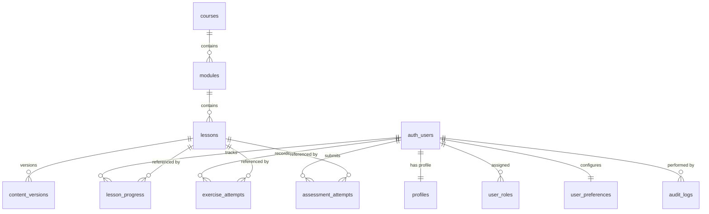
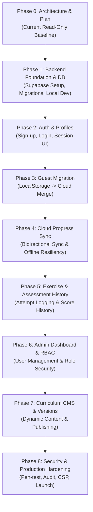

# Backend Requirements and Architecture Specification
## Interactive JavaScript Learning Platform — Phase 0 Architecture Audit & Evolution Plan

**Version:** 1.0  
**Status:** Phase 0 Baseline Proposal (Read-Only Planning)  
**Parent Documents:** `constitution.md`, `requirements.md`, `architecture-spec.md`, `curriculum-spec.md`

---

## 1. Executive Summary & Audit Baseline

The Interactive JavaScript Learning Platform is currently an entirely client-side, zero-backend single-page application built with Vite, vanilla ECMAScript modules, CodeMirror 6, browser Web Workers, Vitest, and Playwright. It is deployable as static HTML, CSS, and JavaScript to any static host (e.g., GitHub Pages, Cloudflare Workers Static Assets).

This document establishes the architectural foundation for evolving the platform from a client-isolated learning tool into a full-scale educational platform supporting:
1. User registration, authentication, and profiles.
2. Cross-device progress synchronization with automatic guest-to-account migration.
3. Persistent exercise attempt history and assessment score tracking.
4. Granular role-based access control (RBAC) separating learners, content editors, and platform administrators.
5. Future-proof course and curriculum management (CMS) without architectural redesign.

**Core Invariant:** Per `constitution.md` §7, `requirements.md` §FR-011, and `architecture-spec.md` §5, student-submitted JavaScript is untrusted code. It **MUST NOT** be executed on the backend. The platform's tri-modal client-side Web Worker architecture (Ordinary Worker, Controlled DOM Worker, Async Worker) is strictly preserved.

---

## 2. Existing Application Architecture Audit

This audit reflects the verified, inspected state of the codebase (`c:\Users\pc\Desktop\javascript-learning\app`).

### 2.1 Application Architecture & Entry Points
- **HTML Host (`app/index.html`):** Loads `src/main.js` as an ES module. Enforces a strict Content Security Policy (`<meta http-equiv="Content-Security-Policy">`) defining `script-src 'self' 'unsafe-eval'`, `worker-src 'self' blob:`, and `connect-src 'self' https://jsonplaceholder.typicode.com`.
- **Entry Point (`app/src/main.js`):** Mounts the application by invoking `createApp(document.getElementById("app"))`.
- **Application Factory (`app/src/app.js`):** Creates the persistent DOM shell (header, sidebar curriculum navigation, lesson content column, playground column). Manages overall state, lesson loading, and the top-level progress counter.

### 2.2 Lesson Rendering and Navigation
- **Curriculum Navigation (`app/src/components/navigation.js`):** Renders accordion-style module and lesson lists. Indicates active lesson, completion checkmarks, and prerequisite gating.
- **Lesson View (`app/src/components/lesson-view.js`):** Renders structured lesson sections, code examples, learning objectives, and summary lists. Purely presenter logic; does not manipulate progress or execution state.

### 2.3 Curriculum Organization
- **Curriculum Definition (`app/src/curriculum.js`):** Canonical metadata for 9 modules and 64 lessons. Provides helpers `getCurriculum()`, `getTotalLessonCount()` (returns 64), `findLessonById(id)`, `findModuleById(id)`, and `getNextLessonId(id)`.
- **Content Registry (`app/src/content/index.js`):** Imports and registers lesson definitions from individual files (`m1-l1.js` through `m9-l9.js`). Enforces structural validation (`assertLessonShape`) at module initialization. All 64 canonical lessons have registered implementations.

### 2.4 Progress Tracking & Storage Audit
- **Module (`app/src/progress.js`):** Manages local storage persistence.
- **Audited `localStorage` Key:** Exactly one key is used:
  ```typescript
  STORAGE_KEY = "jslearn_progress_v1"
  ```
- **Audited Data Structure:**
  ```json
  {
    "schemaVersion": 1,
    "completedLessons": ["m1-l1", "m1-l2", "m2-l1"],
    "lastUpdated": "2026-11-09T14:30:00.000Z"
  }
  ```
- **Characteristics & Limitations:**
  - Idempotent: `completedLessons` is filtered against canonical curriculum lesson IDs and deduplicated via `Set`.
  - Fragile / Ephemeral: Device-bound. Clearing browser data or changing browsers erases all progress.
  - Zero granular history: Does not store current active lesson, exercise code, attempt counts, timestamps per lesson, hint levels unlocked, or quiz selection history.
  - No conflict resolution: Overwritten completely on each `saveProgress()`.

### 2.5 Exercise and Validation Systems
- **Base Validators (`app/src/content/validators.js`):** Provides `createBaseValidator` and helper assertions (`stripTrailingNewlines`, etc.). Evaluates worker output arrays against expected strings, types, and counts.
- **Execution Modes:** Configured per lesson in `exercise.executionMode`:
  1. `worker` (default): Synchronous/pure JavaScript executed in isolated Blob Worker.
  2. `dom`: Interactive virtual DOM simulation for Module 6 executed via `dom-runner.js` and `dom-worker.js`.
  3. `async-worker`: Asynchronous execution for Module 7 with tracked microtasks/macrotasks and a mediated host fetch bridge.
  4. `knowledge-check`: Non-executing multiple-choice quizzes (`app/src/components/knowledge-check.js`).

### 2.6 Assessment Functionality
- **Dual Assessment Model (`app/src/components/playground.js`):** Certain lessons (e.g., `m8-l6`, `m8-l7`) enforce both a coding exercise and a supplemental `comprehensionCheck` (knowledge check). A lesson is marked complete (`markLessonComplete`) **only** when both assessments pass.
- **Knowledge Check Form (`app/src/components/knowledge-check.js`):** Multiple-choice radio button form. Grades answers on client against `correctOptionId`. State is held purely in DOM/closures and discarded upon navigation.

### 2.7 Worker Architecture & Execution Protocols
- **Synchronous Runner (`app/src/runner.js`):** Spawns an inlined Blob Web Worker. Strips `fetch`, `XMLHttpRequest`, `WebSocket`, `EventSource`, `indexedDB`, `caches`, `importScripts`, `Function.prototype.constructor`, `eval`, and `postMessage`. Employs a 5,000ms watchdog timer (`worker.terminate()`). Caps output at 100 entries and 2,000 characters per entry.
- **DOM Runner (`app/src/dom-runner.js`):** Communicates with external module worker `dom-worker.js`. Implements a virtual DOM tree (max 200 nodes, depth 20, 50 event listeners). Renders snapshots to `dom-preview.js` using safe DOM APIs (`textContent`, native controls). No raw HTML injection.
- **Async Runner (`app/src/async-runner.js`):** Manages `async-worker.js`. Tracks `setTimeout` up to 50 registrations, resolves top-level async functions, drains microtasks, and bridges strictly allowlisted GET requests to `https://jsonplaceholder.typicode.com/todos/1` via `async-fetch.js`.

### 2.8 Existing Tests and Tooling
- **Unit & Integration Tests:** Vitest (`app/package.json`, 27+ test files). Covers progress, curriculum, runner execution boundaries, DOM policies, async fetching, and individual lesson validators.
- **End-to-End Tests:** Playwright (`app/e2e/*.spec.js`). Real browser testing covering navigation, startup, responsive layout, exercise feedback, worker loop termination, and dual assessments.

### 2.9 Existing Backend / Authentication Functionality
- **Audit Result:** **Zero.** There is no authentication client, user session management, backend API client, or remote database integration in the existing codebase.

### 2.10 Discontinued Initiatives
- **Animated Explanations (`feature-spec-animated-explanations.md`, `lesson-animation.js`):** Formally discontinued. Per project instructions, this initiative remains stopped and will not be carried into backend planning.

---

## 3. Backend Functional Requirements Specification

Requirements are categorized into:
- **MVP (Release 1.0):** Essential core to establish registered learning, cloud sync, and data persistence.
- **Subsequent Releases (Release 2.0):** Role-based administration, attempt history analytics, and reporting.
- **Future Enhancements (Release 3.0+):** Dynamic CMS, content versioning, and community features.

```
┌────────────────────────────────────────────────────────────────────────┐
│                        REQUIREMENTS HIERARCHY                          │
├───────────────────┬────────────────────────────┬───────────────────────┤
│    MVP (R1.0)     │      Subsequent (R2.0)     │     Future (R3.0+)    │
├───────────────────┼────────────────────────────┼───────────────────────┤
│ • Auth & Profiles │ • Role-Based Admin (RBAC)  │ • Full Dynamic CMS    │
│ • Guest Migration │ • Exercise History/Code    │ • Content Versioning  │
│ • Progress Sync   │ • Assessment Scoring/Logs  │ • Multi-Course Engine │
│ • Account Deletion│ • Learning Analytics / BI  │ • Audit Log System    │
└───────────────────┴────────────────────────────┴───────────────────────┘
```

### 3.1 Authentication & Account Management
| ID | Requirement | Description | Target Release |
|---|---|---|---|
| **AUTH-01** | User Registration | Self-service email & password registration with password complexity requirements (min 8 chars, 1 uppercase, 1 number). | MVP |
| **AUTH-02** | User Login / Logout | Secure login issuing JWT access/refresh tokens. Instant client session clearance on logout. | MVP |
| **AUTH-03** | Password Recovery | Automated email dispatch with time-bounded, secure reset tokens. | MVP |
| **AUTH-04** | Email Verification | Email confirmation workflow to verify ownership prior to sensitive operations. | MVP |
| **AUTH-05** | User Profiles | Storage of display name, avatar URL, created timestamp, and last active timestamp. | MVP |
| **AUTH-06** | Session Handling | Secure token storage in browser (localStorage/memory with refresh rotation). Automatic silent token renewal. | MVP |
| **AUTH-07** | Account Deletion | GDPR "Right to be Forgotten" self-service deletion. Cascades and deletes all user-linked progress, attempts, and profiles. | MVP |
| **AUTH-08** | OAuth Social Login | Optional Google/GitHub OAuth sign-in. | Subsequent |

### 3.2 Learning Progress & Synchronization
| ID | Requirement | Description | Target Release |
|---|---|---|---|
| **PROG-01** | Completed Lessons Sync | Cloud persistence of all completed canonical lesson IDs with completion timestamps. | MVP |
| **PROG-02** | Active Lesson State | Cloud persistence of the user's current module and active lesson ID across devices. | MVP |
| **PROG-03** | Module & Overall Progress | Dynamic calculation of module-level and platform-level completion percentages. | MVP |
| **PROG-04** | Cross-Device Sync | Automatic progress pull on login; push on completion. Resolves multi-device divergence via union merge. | MVP |
| **PROG-05** | Guest Migration | Automatic detection and seamless upload of guest `localStorage` records upon sign-up or first login. | MVP |
| **PROG-06** | Offline Resilience | Local caching of progress mutations during network disconnect; queue-based sync upon reconnection. | MVP |

### 3.3 Exercises & Assessments
| ID | Requirement | Description | Target Release |
|---|---|---|---|
| **EXER-01** | Attempt Logging | Storing timestamped records of exercise runs (passed/failed, execution time, error kind). | Subsequent |
| **EXER-02** | Code Snapshots | Persisting user's submitted code solutions for completed lessons for later review. | Subsequent |
| **EXER-03** | Assessment Scores | Recording knowledge-check quiz attempts, selected options, pass/fail status, and attempt counts. | Subsequent |
| **EXER-04** | Personal Statistics | Learner dashboard displaying total time spent, completion velocity, and exercise success rate. | Subsequent |

### 3.4 Administration & Operational Governance
| ID | Requirement | Description | Target Release |
|---|---|---|---|
| **ADMIN-01** | Role-Based Access Control | Strict separation of `learner`, `content_editor`, and `admin` roles. | Subsequent |
| **ADMIN-02** | User Management | Admin dashboard to list learners, view completion stats, ban/suspend accounts, and force resets. | Subsequent |
| **ADMIN-03** | Privilege Escalation Block | Absolute guarantee that users cannot alter their own `role` or elevate permissions via client manipulation. | MVP (Schema level) |
| **ADMIN-04** | Platform Statistics | Aggregate analytics (daily active learners, module drop-off curves, most failed exercises). | Subsequent |
| **ADMIN-05** | Administrative Audit Log | Tamper-evident logging of all admin actions (role changes, user bans, content updates). | Future |

### 3.5 Course & Content Management (CMS)
| ID | Requirement | Description | Target Release |
|---|---|---|---|
| **CMS-01** | Static-First Baseline | Lessons continue loading from static client bundles for speed, zero API cost, and offline operation. | MVP |
| **CMS-02** | Dynamic Curriculum DB | Relational representation of Courses, Modules, Lessons, and Exercises in Postgres. | Future |
| **CMS-03** | Content Versioning | Version tags on lesson definitions allowing curriculum updates without invalidating historical progress. | Future |
| **CMS-04** | Publication Workflow | Draft vs Published status for lessons; content-editors can stage lessons prior to release. | Future |

---

## 4. Guest and Registered-User Access Specification

```
┌────────────────────────────────────────────────────────────────────────┐
│                        ROLE CAPABILITY MATRIX                          │
├──────────────────────────┬───────────┬─────────────┬───────────┬───────┤
│ Capability               │   Guest   │   Learner   │  Editor   │ Admin │
├──────────────────────────┼───────────┼─────────────┼───────────┼───────┤
│ View lessons & run code  │     ✅     │      ✅      │     ✅     │   ✅   │
│ Local progress save      │     ✅     │      ✅      │     ✅     │   ✅   │
│ Cloud progress sync      │     ❌     │      ✅      │     ✅     │   ✅   │
│ Cross-device history     │     ❌     │      ✅      │     ✅     │   ✅   │
│ Saved code snapshots     │     ❌     │      ✅      │     ✅     │   ✅   │
│ User profile & settings  │     ❌     │      ✅      │     ✅     │   ✅   │
│ Edit lesson content      │     ❌     │      ❌      │     ✅     │   ✅   │
│ View platform analytics  │     ❌     │      ❌      │     ❌     │   ✅   │
│ Manage users & roles     │     ❌     │      ❌      │     ❌     │   ✅   │
└──────────────────────────┴───────────┴─────────────┴───────────┴───────┘
```

### 4.1 Guest Learners
- **Access Rule:** Open access to all 64 lessons, interactive playground, and exercises. No login wall.
- **Persistence Boundary:** Data strictly restricted to `localStorage` (`jslearn_progress_v1`).
- **Network Boundary:** No authenticated API calls; zero personal data collected.

### 4.2 Registered Learners
- **Access Rule:** Standard authenticated user role (`learner`).
- **Capabilities:** Automatically syncs progress across devices, saves exercise code snapshots, retains quiz scores, customizes profile and learning preferences.
- **Data Isolation:** Enforced via Postgres Row Level Security (RLS) (`auth.uid() = user_id`). Learners can only read and write their own data.

### 4.3 Content Editor Role Evaluation
- **Evaluation:** Is a dedicated `content_editor` role necessary?
- **Finding:** **Yes, for future releases (Phase 7 / CMS).** 
  - *Rationale:* Principle of Least Privilege. Curriculum designers need to update lesson copy, hint texts, and starter code without possessing rights to delete user accounts, alter database permissions, or view sensitive operational logs.
  - *MVP Status:* In MVP and Release 1.0, content remains version-controlled in Git (`src/content/`). Therefore, `content_editor` role is deferred to Phase 6/7, but the schema must accommodate it immediately via an extensible role enum.

### 4.4 Platform Administrators
- **Access Rule:** Users holding the `admin` role in `user_roles`.
- **Capabilities:** Access to `/admin` routes, user management, audit review, and global analytics.
- **Security Invariant:** User registration endpoints **never** accept a role parameter. Role assignment is restricted to database migrations, server-side service-role execution, or direct admin management via restricted RPC functions.

---

## 5. Progress Migration and Synchronization Design

### 5.1 LocalStorage Baseline
The audited client storage contains:
```json
{
  "schemaVersion": 1,
  "completedLessons": ["m1-l1", "m1-l2", "m2-l1"],
  "lastUpdated": "2026-11-09T14:30:00.000Z"
}
```
Only completed lesson IDs are stored.

### 5.2 Guest-to-Account Migration Flow
When an unregistered user who has completed lessons registers or logs into an account:

```
[User Registers / Logs In]
          │
          ▼
[Check LocalStorage: jslearn_progress_v1]
          │
    ┌─────┴────────────────┐
    │                      │
[Has Local Progress]  [Empty Local Progress]
    │                      │
    ▼                      ▼
[Fetch Cloud Progress] [Fetch Cloud Progress]
    │                      │
    ▼                      ▼
[Execute Set Union]    [Write Cloud -> Local]
  Local ∪ Cloud            │
    │                      ▼
    ▼                  [Complete]
[Atomic DB Upsert]
    │
    ▼
[Update LocalStorage]
    │
    ▼
[Sync Complete]
```

### 5.3 Conflict Resolution Strategy: Set Union Merge
Because learning progress is intrinsically monotonic (a lesson once mastered remains completed), conflict resolution between local storage and cloud storage avoids destructive overwrites by applying **Mathematical Set Union**:

$$\text{Merged Completed} = \text{Local Completed} \cup \text{Cloud Completed}$$

$$\text{Merged Updated} = \max(\text{Local } lastUpdated, \text{Cloud } lastUpdated, \text{Now})$$

**Rules:**
1. **Never Overwrite with Less:** If a user completed 10 lessons on Device A (guest) and 15 lessons on Device B (registered), the merged state must contain all unique completed lessons from both (up to 25).
2. **Current Active Lesson:** Resolved via Last-Write-Wins (LWW) using the `updated_at` ISO-8601 timestamp.
3. **Idempotency:** Cloud synchronization uses SQL `ON CONFLICT (user_id, lesson_id) DO NOTHING` or `DO UPDATE SET updated_at = EXCLUDED.updated_at`.
4. **Offline Queue:** If a learner completes a lesson while offline:
   - Mark as completed in `localStorage`.
   - Append mutation to an in-memory / `localStorage` mutation queue: `[{ action: "COMPLETE", lessonId: "m3-l1", timestamp: "..." }]`.
   - Upon `navigator.onLine` event or subsequent app launch, process the queue with exponential backoff retry.
5. **Debounce & Batching:** Frequent updates (e.g. active lesson changes) are debounced on the client by 1,500ms to eliminate redundant network roundtrips.

---

## 6. Backend Technology Comparison and Recommendation

### 6.1 Technology Evaluation

| Dimension | Option A: Supabase (Recommended) | Option B: Custom Node.js + Express/Fastify + PostgreSQL |
|---|---|---|
| **Architecture** | Managed PostgreSQL + PostgREST + GoTrue Auth + Realtime + Edge Functions. | Custom Node.js API server + ORM (Prisma/Drizzle) + PostgreSQL DB. |
| **Authentication** | Built-in GoTrue (JWT, email confirmation, password reset, OAuth). | Requires manual setup (Passport/Lucia, email transport, token rotation). |
| **Data Authorization** | Native PostgreSQL Row Level Security (RLS) enforced at the database kernel. | Application-layer middleware; vulnerability to authorization logic bugs. |
| **Frontend Static Hosting** | **100% Compatible.** Client connects directly via `supabase-js` using public anon key. App stays static on Cloudflare/GitHub Pages. | Requires hosting, deploying, monitoring, and scaling a dedicated Node.js runtime container. |
| **Local Development** | Supabase CLI runs exact local stack via Docker (`supabase start`). | Standard `docker-compose` with Node.js and Postgres. |
| **Testing** | Standard Vitest integration tests against local Supabase instance. RLS testable via `pgTAP` or Node SDK. | Standard integration tests using Supertest and Vitest. |
| **Maintenance Burden** | Minimal. Zero backend code to patch for security, routing, or connection pooling. | High. Must maintain Node.js dependencies, server security, TLS, rate limiters, Docker containers. |
| **Free Tier Constraints** | 500MB database, 50,000 monthly active users, 2 projects. (Sufficient for initial 10,000+ learners). | VPS cost ($5–$10/month minimum) + database management. |

### 6.2 Recommendation: Supabase
**Supabase is decisively recommended** for the platform evolution:
1. **Preserves Static Frontend:** The existing Vite build architecture remains deployable to GitHub Pages or Cloudflare Workers Static Assets with zero server hosting costs.
2. **PostgreSQL Security Model:** Enforces security at the database layer via RLS policies. Even if client-side code is tampered with, the PostgreSQL engine refuses unauthorized reads or writes.
3. **Reduced Code Surface:** Eliminates thousands of lines of boilerplate CRUD, JWT verification, and email reset code, letting development focus on curriculum and learner progress.
4. **Smooth Migration Path:** If proprietary constraints ever dictate moving away from Supabase, the underlying database is pure, standard PostgreSQL with standard SQL migrations, readily portable to AWS RDS, Google Cloud SQL, or self-hosted PostgreSQL.

---

## 7. Proposed Relational Database Architecture

All database timestamps use `TIMESTAMPTZ` with `DEFAULT timezone('utc'::text, now())`. UUIDs use `gen_random_uuid()`.

### 7.1 Entity-Relationship Overview



### 7.2 MVP Database Tables (Release 1.0)

#### 1. `profiles`
- **Purpose:** Stores public and semi-public learner identity linked to `auth.users`.
- **Fields:**
  - `id` (UUID, Primary Key, References `auth.users.id` ON DELETE CASCADE)
  - `display_name` (TEXT, Nullable, max 50 chars)
  - `avatar_url` (TEXT, Nullable)
  - `created_at` (TIMESTAMPTZ, NOT NULL, DEFAULT now())
  - `updated_at` (TIMESTAMPTZ, NOT NULL, DEFAULT now())
- **Constraints & Indexes:**
  - PK: `id`
  - Index: `profiles_created_at_idx` ON `created_at`
- **RLS Requirements:**
  - `SELECT`: Authenticated users can view any profile (or only own profile if private).
  - `UPDATE`: Authenticated users can only update their own profile (`auth.uid() = id`).
  - `INSERT`: Created automatically via Postgres trigger on `auth.users` creation.

#### 2. `user_roles`
- **Purpose:** Manages system roles (`learner`, `content_editor`, `admin`).
- **Fields:**
  - `id` (UUID, Primary Key, DEFAULT gen_random_uuid())
  - `user_id` (UUID, NOT NULL, References `auth.users.id` ON DELETE CASCADE)
  - `role` (TEXT, NOT NULL, CHECK `role IN ('learner', 'content_editor', 'admin')`, DEFAULT `'learner'`)
  - `created_at` (TIMESTAMPTZ, NOT NULL, DEFAULT now())
- **Constraints & Indexes:**
  - Unique: `(user_id, role)`
  - Index: `user_roles_user_id_idx` ON `user_id`
- **RLS Requirements:**
  - `SELECT`: User can read their own roles (`auth.uid() = user_id`); Admins can read all.
  - `INSERT / UPDATE / DELETE`: Denied to all client queries. Only modifiable via service-role key or admin RPC function.

#### 3. `lesson_progress`
- **Purpose:** Records lesson completion and active learning state per user.
- **Fields:**
  - `id` (UUID, Primary Key, DEFAULT gen_random_uuid())
  - `user_id` (UUID, NOT NULL, References `auth.users.id` ON DELETE CASCADE)
  - `lesson_id` (TEXT, NOT NULL) — e.g. `'m1-l1'`
  - `status` (TEXT, NOT NULL, CHECK `status IN ('started', 'completed')`, DEFAULT `'completed'`)
  - `completed_at` (TIMESTAMPTZ, Nullable)
  - `created_at` (TIMESTAMPTZ, NOT NULL, DEFAULT now())
  - `updated_at` (TIMESTAMPTZ, NOT NULL, DEFAULT now())
- **Constraints & Indexes:**
  - Unique: `(user_id, lesson_id)`
  - Index: `lesson_progress_user_id_idx` ON `user_id`
  - Index: `lesson_progress_lesson_id_idx` ON `lesson_id`
- **RLS Requirements:**
  - `SELECT`: Users read only their own records (`auth.uid() = user_id`).
  - `INSERT / UPDATE`: Users upsert only their own records (`auth.uid() = user_id`).
  - `DELETE`: Users can delete their own records (reset progress).

#### 4. `user_preferences`
- **Purpose:** Stores user interface and editor preferences across devices.
- **Fields:**
  - `user_id` (UUID, Primary Key, References `auth.users.id` ON DELETE CASCADE)
  - `theme` (TEXT, NOT NULL, DEFAULT `'dark'`, CHECK `theme IN ('dark', 'light', 'system')`)
  - `font_size` (INTEGER, NOT NULL, DEFAULT 14, CHECK `font_size BETWEEN 10 AND 24`)
  - `active_lesson_id` (TEXT, NOT NULL, DEFAULT `'m1-l1'`)
  - `updated_at` (TIMESTAMPTZ, NOT NULL, DEFAULT now())
- **RLS Requirements:**
  - `ALL`: Restricted to `auth.uid() = user_id`.

### 7.3 Subsequent Release Tables (Release 2.0)

#### 5. `exercise_attempts`
- **Purpose:** Audit history of code submissions and exercise executions.
- **Fields:**
  - `id` (UUID, Primary Key, DEFAULT gen_random_uuid())
  - `user_id` (UUID, NOT NULL, References `auth.users.id` ON DELETE CASCADE)
  - `lesson_id` (TEXT, NOT NULL)
  - `exercise_id` (TEXT, NOT NULL)
  - `passed` (BOOLEAN, NOT NULL)
  - `code_snippet` (TEXT, NOT NULL) — Capped at 10,000 chars
  - `execution_time_ms` (INTEGER, Nullable)
  - `error_type` (TEXT, Nullable)
  - `created_at` (TIMESTAMPTZ, NOT NULL, DEFAULT now())
- **Indexes:**
  - Index: `exercise_attempts_user_lesson_idx` ON `(user_id, lesson_id)`
- **RLS Requirements:**
  - `SELECT`: User views own attempts; Admins view all.
  - `INSERT`: User inserts own attempts. No client `UPDATE` or `DELETE` allowed.

#### 6. `assessment_attempts`
- **Purpose:** Records knowledge-check quiz submissions and scores.
- **Fields:**
  - `id` (UUID, Primary Key, DEFAULT gen_random_uuid())
  - `user_id` (UUID, NOT NULL, References `auth.users.id` ON DELETE CASCADE)
  - `lesson_id` (TEXT, NOT NULL)
  - `assessment_id` (TEXT, NOT NULL)
  - `answers` (JSONB, NOT NULL) — e.g. `{"q1": "sync-end", "q2": "promise-job"}`
  - `score` (NUMERIC(5,2), NOT NULL) — e.g. 100.00
  - `passed` (BOOLEAN, NOT NULL)
  - `created_at` (TIMESTAMPTZ, NOT NULL, DEFAULT now())
- **RLS Requirements:**
  - `SELECT`: User views own; Admins view all.
  - `INSERT`: User inserts own.

### 7.4 Future Release Tables (Release 3.0+ / CMS & Audit)

#### 7. `courses`, `modules`, `lessons`, and `content_versions`
- **Purpose:** Migrates static JavaScript content files (`m1-l1.js`) into a database-backed Content Management System.
- **Key Relationships:**
  - `courses` 1 : N `modules`
  - `modules` 1 : N `lessons`
  - `lessons` 1 : N `content_versions`
- **RLS Requirements:**
  - Public read access for published lessons; write access restricted to `content_editor` and `admin` roles.

#### 8. `audit_logs`
- **Purpose:** Immutable compliance log recording sensitive administrator operations.
- **Fields:**
  - `id` (UUID, Primary Key)
  - `admin_id` (UUID, References `auth.users.id`)
  - `action` (TEXT, NOT NULL) — e.g. `'BAN_USER'`, `'UPDATE_ROLE'`
  - `target_id` (TEXT, NOT NULL)
  - `payload` (JSONB)
  - `ip_address` (INET)
  - `created_at` (TIMESTAMPTZ, NOT NULL, DEFAULT now())
- **RLS Requirements:**
  - Only accessible by `admin`. No updates or deletions permitted.

---

## 8. Security and Privacy Architecture

```
┌────────────────────────────────────────────────────────────────────────┐
│                        SECURITY PERIMETER                              │
├────────────────────────────────────────────────────────────────────────┤
│  BROWSER CONTEXT                                                       │
│  ┌───────────────────────┐         ┌───────────────────────────────┐  │
│  │ Platform Host UI      │         │ Isolated Web Worker           │  │
│  │ (CodeMirror, Progress)│◄───────►│ (Untrusted Student JS)        │  │
│  │ Holds: Supabase Anon  │ postMsg │ NO Network, NO Storage, NO DOM│  │
│  └───────────┬───────────┘         └───────────────────────────────┘  │
│              │ HTTPS                                                   │
├──────────────┼─────────────────────────────────────────────────────────┤
│  SUPABASE / POSTGRES                                                   │
│              ▼                                                         │
│  ┌──────────────────────────────────────────────────────────────────┐  │
│  │ API Gateway & GoTrue Auth (Rate Limiting, JWT Validation)        │  │
│  ├──────────────────────────────────────────────────────────────────┤  │
│  │ PostgreSQL Kernel with Row Level Security (RLS)                  │  │
│  │ • Learners isolated by auth.uid()                                │  │
│  │ • Admins verified via user_roles / custom security definer func │  │
│  │ • Service-Role Key isolated from client bundles                  │  │
│  └──────────────────────────────────────────────────────────────────┘  │
└────────────────────────────────────────────────────────────────────────┘
```

### 8.1 Untrusted Learner Code Execution: Absolute Client-Side Isolation
- **Preservation Principle:** In compliance with `constitution.md` § Principle VIII & §7, student-submitted code is **never sent to or executed on the backend**.
- Moving execution to the backend would introduce catastrophic remote code execution (RCE) risks, container escape risks, and massive compute costs.
- The existing browser-based Web Worker architecture (with stripped global capabilities and parent-thread watchdog termination) remains the sole execution engine.

### 8.2 API Keys & Credential Hygiene
- **Public Anon Key (`VITE_SUPABASE_ANON_KEY`):**
  - Safe for client-side inclusion. It acts only as an identifier and is strictly constrained by PostgreSQL RLS.
- **Service-Role Key (`SUPABASE_SERVICE_ROLE_KEY`):**
  - **NEVER** placed in frontend source code, environment variables prefixed with `VITE_`, or client bundles.
  - Used exclusively in secure server-side environments (Supabase Edge Functions or administrative deployment scripts).

### 8.3 Row Level Security (RLS) Policies
Every table has RLS explicitly enabled:
```sql
ALTER TABLE lesson_progress ENABLE ROW LEVEL SECURITY;
```
Example policy strictly enforcing user isolation:
```sql
CREATE POLICY "Learners can manage own progress"
ON lesson_progress
FOR ALL
TO authenticated
USING (auth.uid() = user_id)
WITH CHECK (auth.uid() = user_id);
```

### 8.4 Administrator Privilege Verification
To eliminate privilege escalation:
- Roles are never stored in user-editable tables or client-controlled JWT metadata.
- Secure Postgres Security Definer helper:
  ```sql
  CREATE OR REPLACE FUNCTION is_admin()
  RETURNS BOOLEAN AS $$
  BEGIN
    RETURN EXISTS (
      SELECT 1 FROM user_roles
      WHERE user_id = auth.uid() AND role = 'admin'
    );
  END;
  $$ LANGUAGE plpgsql SECURITY DEFINER;
  ```
- Admin-only RLS policies call `is_admin()`.

### 8.5 Input Validation & Rate Limiting
- **Client & Server Validation:** Code snippets submitted for attempt history are capped at 10,000 characters. Input fields are sanitized.
- **Rate Limiting:** Managed at the API gateway layer (Supabase Kong API Gateway):
  - Auth endpoints (login/signup): Max 30 requests/minute per IP to prevent credential stuffing.
  - Progress updates: Debounced client-side (1,500ms); rate-limited to 60 requests/minute per user.

### 8.6 Privacy, GDPR Compliance & Account Deletion
- **Data Minimization:** No personal data collected for guests. For registered users, only email and optional display name are collected.
- **Self-Service Account Deletion:** Triggering account deletion invokes `supabase.rpc('delete_user_account')` or cascades from `auth.users`, automatically removing:
  - `profiles`
  - `user_roles`
  - `lesson_progress`
  - `exercise_attempts`
  - `assessment_attempts`
  - `user_preferences`
- **Data Export:** Learners can export their progress and attempt history as a standard JSON document.

---

## 9. Phased Implementation Roadmap



### Phase 0: Requirements and Architecture (CURRENT PHASE)
- **Status:** **COMPLETE** (Read-Only Audit & Specification).
- **Scope:** Source code inspection, requirements breakdown, tech comparison, database schema design, and roadmap. Zero code modifications.

---

### Phase 1: Backend Foundation and Database
- **Objectives:** Initialize Supabase infrastructure, configure local development via Docker CLI, and write SQL migrations for MVP tables.
- **Scope:**
  - Supabase CLI setup (`supabase/config.toml`).
  - Migration script creating `profiles`, `user_roles`, `lesson_progress`, `user_preferences`.
  - Enable RLS and define baseline security policies.
  - Automated database integration tests (verifying RLS isolation).
- **Dependencies:** Approval of Phase 0 architecture.
- **Affected Files:** New folder `supabase/migrations/`, `supabase/seed.sql`, test scripts. (No frontend changes).
- **Acceptance Criteria:**
  - Local Supabase instance runs via `supabase start`.
  - Migrations apply cleanly and idempotently.
  - RLS verification tests confirm unauthorized users cannot read or write foreign rows.
- **Risks & Rollback:** Zero frontend risk. Rollback by resetting local database via `supabase db reset`.

---

### Phase 2: Authentication and User Profiles
- **Objectives:** Introduce user sign-up, sign-in, sign-out, password reset, and profile management into the application interface.
- **Scope:**
  - Install `@supabase/supabase-js`.
  - Create Auth Service (`src/services/auth.js`) managing active session state and auth listeners.
  - Implement accessible authentication UI modal or header controls (Login / Sign Up / Profile dropdown).
  - Profile editing (display name).
- **Dependencies:** Phase 1 completion.
- **Affected Files:** `app/src/services/auth.js`, `app/src/components/auth-modal.js`, `app/src/app.js`, `app/src/style.css`.
- **Database Changes:** Trigger on `auth.users` to automatically populate `profiles` and `user_roles` with `'learner'`.
- **Acceptance Criteria:**
  - Guest can register with email and password.
  - Confirmation email dispatched.
  - Login persists session across reloads.
  - Logout clears active session cleanly.
- **Required Tests:** Unit tests for Auth Service; Playwright E2E tests for registration and login workflows.
- **Security Considerations:** Ensure no tokens or passwords leak to console logs or untrusted worker contexts.

---

### Phase 3: Guest-to-Account Migration
- **Objectives:** Seamlessly merge local guest progress into newly registered or logged-in accounts.
- **Scope:**
  - Create Migration Engine (`src/services/migration.js`).
  - Detect `jslearn_progress_v1` on auth state change (`SIGNED_IN`).
  - Perform Set Union merge with cloud records.
  - Persist merged union to database and refresh `localStorage`.
- **Dependencies:** Phase 2 completion.
- **Affected Files:** `app/src/services/migration.js`, `app/src/progress.js`, `app/src/app.js`.
- **Database Changes:** Postgres RPC function `merge_user_progress(lesson_ids TEXT[])` for atomic execution.
- **Acceptance Criteria:**
  - Guest completes Lessons 1–3, creates an account; cloud immediately stores Lessons 1–3.
  - If cloud already had Lesson 4, user now has Lessons 1–4 on both device and cloud.
  - Zero data loss or progress rollback.
- **Required Tests:** Unit tests with mock localStorage; E2E tests verifying multi-device progress union.

---

### Phase 4: Cloud Progress Synchronization
- **Objectives:** Real-time and background progress synchronization with offline resilience.
- **Scope:**
  - Refactor `app/src/progress.js` to coordinate between `localStorage` (cache) and Supabase (remote).
  - Queue offline completions and drain queue when `navigator.onLine` fires.
  - Update header progress indicator (`X/64`) based on synced state.
- **Dependencies:** Phase 3 completion.
- **Affected Files:** `app/src/progress.js`, `app/src/services/sync.js`, `app/src/app.js`.
- **Acceptance Criteria:**
  - Completing an exercise immediately updates local UI and asynchronously persists to cloud.
  - Logging in on a second device displays identical completion count without manual refresh.
  - Network disconnection does not block exercise completion; syncs upon reconnect.
- **Required Tests:** Offline network simulation tests in Playwright.

---

### Phase 5: Exercise and Assessment History
- **Objectives:** Persist code submissions, execution status, and quiz responses for analytics and review.
- **Scope:**
  - Apply Release 2.0 migrations (`exercise_attempts`, `assessment_attempts`).
  - Record code snapshots upon successful exercise completion.
  - Record multiple-choice knowledge check selections.
  - Add learner history modal showing past attempts.
- **Dependencies:** Phase 4 completion.
- **Affected Files:** `app/src/components/playground.js`, `app/src/components/knowledge-check.js`, `app/src/services/history.js`.
- **Acceptance Criteria:**
  - Failed and successful runs recorded with timestamp and error categorization.
  - Learners can view their previously submitted working solution.
- **Required Tests:** Unit tests for history persistence and payload truncation (max 10,000 chars).

---

### Phase 6: Administration and Role-Based Access
- **Objectives:** Build an administrative console to manage learners, roles, and platform metrics.
- **Scope:**
  - Admin layout and routes (`/admin`).
  - Learner table with search, completion stats, and account moderation.
  - Security audit confirming unprivileged users cannot access `/admin` or invoke admin RPCs.
- **Dependencies:** Phase 5 completion.
- **Affected Files:** `app/src/components/admin/*`, `app/src/services/admin.js`.
- **Database Changes:** Admin RPC functions (`get_platform_metrics`, `set_user_role`).
- **Acceptance Criteria:**
  - Only users with `user_roles.role = 'admin'` can load the admin panel.
  - Tampering with client state triggers 403 Forbidden from Postgres RLS.
- **Required Tests:** Security penetration tests attempting unauthorized privilege escalation.

---

### Phase 7: Curriculum and Content Management (CMS)
- **Objectives:** Enable dynamic lesson editing, versioning, and draft publication via database.
- **Scope:**
  - Apply Release 3.0 migrations (`courses`, `modules`, `lessons`, `content_versions`).
  - Create hybrid content loader: fetch from database with fallback to static bundles (`src/content/`).
  - Content editor interface for staging new lessons.
- **Dependencies:** Phase 6 completion.
- **Affected Files:** `app/src/content/index.js`, `app/src/services/content.js`.
- **Acceptance Criteria:**
  - Editing a lesson via CMS updates content for learners without requiring a frontend redeployment.
  - Platform remains 100% functional offline using static fallback bundles.
- **Required Tests:** Fallback tests simulating database downtime.

---

### Phase 8: Security Hardening and Production Readiness
- **Objectives:** Production deployment verification, CSP tightening, penetration testing, and launch.
- **Scope:**
  - Update production Content Security Policy (`connect-src` allowing Supabase project URL).
  - Enforce SSL, HSTS, and strict CORS.
  - Conduct full accessibility (WCAG AA) and cross-browser regression test (Chrome, Edge, Firefox, Safari).
  - Final release checklist sign-off.
- **Dependencies:** Phases 1–7.
- **Affected Files:** `app/index.html`, `app/vite.config.js`, `app/public/_headers`, `release-checklist.md`.
- **Acceptance Criteria:**
  - 100% passing automated test suite (Vitest + Playwright).
  - Zero critical or high security vulnerabilities.
  - Production deployment verified on Cloudflare Workers Static Assets or GitHub Pages.

---

## 10. Open Architectural Questions and Decisions Requiring Approval

The following architectural questions and decision gates are submitted for user review and approval prior to beginning Phase 1 implementation:

### Decision Gate 1: Supabase vs Custom Node.js Backend
- **Proposal:** Adopt Supabase (Managed Postgres + GoTrue + RLS) to preserve static frontend hosting (GitHub Pages / Cloudflare) and avoid server maintenance.
- **Question for User:** Do you confirm Supabase as the platform backend, or do your organizational constraints require an in-house custom Node.js/Express API server?

### Decision Gate 2: Email Verification Requirement for MVP
- **Proposal:** Require email verification for password recovery and account deletion, but allow immediate platform access and cloud sync upon initial registration before email confirmation is clicked.
- **Question for User:** Should email confirmation be a hard blocker before any cloud synchronization can occur, or should learners experience a frictionless onboarding with background confirmation?

### Decision Gate 3: Inactive Guest Storage Retention
- **Proposal:** Guest progress is stored indefinitely in browser `localStorage`. When a user registers, their `localStorage` is preserved alongside the cloud copy.
- **Question for User:** Should `localStorage` progress be cleared upon sign-out to protect shared computers (e.g. school/library labs), or retained so the device remains usable in guest mode? (Recommended: Retain local copy unless user explicitly clicks "Reset Progress" or selects "This is a public computer" during logout).

### Decision Gate 4: Code Snapshot Storage Scope
- **Proposal:** Store code snapshots only for completed, passing exercises to conserve database storage and avoid storing intermediate keystrokes.
- **Question for User:** Is storing only passing exercise solutions sufficient for Release 2.0, or do you require capturing all failed attempts for instructional debugging?

---

*End of Phase 0 Specification. Implementation is paused pending user review and approval.*

