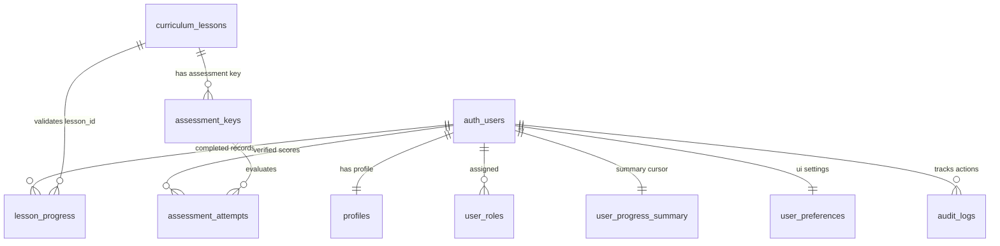
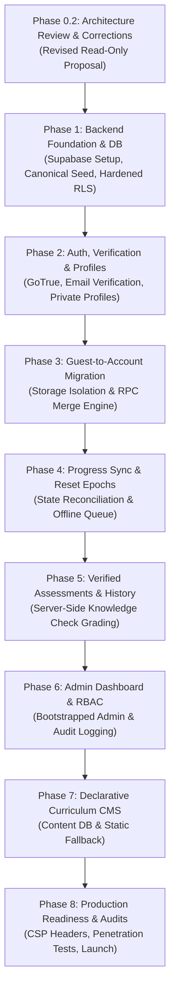

# Backend Requirements and Architecture Specification
## Interactive JavaScript Learning Platform — Phase 0.2 Architecture Review and Final Corrections

**Version:** 2.1  
**Status:** Revised architecture proposal — pending product-owner approval (read-only planning)  
**Parent Documents:** `constitution.md`, `requirements.md`, `architecture-spec.md`, `curriculum-spec.md`  
**Supersedes:** `backend-architecture-spec.md` v1.0 and Phase 0.1 v2.0

---

## 1. Executive Summary & Review Baseline

This document presents the revised, hardened backend architecture and functional requirements specification for evolving the Interactive JavaScript Learning Platform from a client-isolated static web application into a complete, secure, multi-tier educational platform.

### User-Confirmed Product Requirements and Proposed Technical Direction
1. **Product Scope (User-confirmed):** Evolve toward a complete learning platform with learner accounts, progress, assessments, administration, and future curriculum management.
2. **Access Model (User-confirmed):** Support both anonymous **Guest Learners** and authenticated **Registered Learners**.
3. **Execution Integrity (Existing architectural invariant):** Student-submitted JavaScript execution remains in the browser across the established tri-modal Web Worker architecture (Ordinary Worker, Controlled DOM Worker, Async Worker). No untrusted learner code executes on the backend.
4. **Static Frontend (Existing architectural direction):** Keep the Vite frontend deployable as a static application.
5. **Backend Platform (Proposed, not yet finally approved):** Supabase is the recommended candidate, subject to approval of this specification and verification of current plan limits and operational requirements.

### Corrections & Hardening Introduced in Version 2.1
- **Progress Sync & Reset Semantics:** Replaced client-clock-based reset checks with a server-issued `reset_generation` token carried by each queued mutation. A reset increments the generation; operations from older generations are rejected regardless of client clock settings.
- **Storage Boundary Isolation:** Namespaced guest and per-account application caches to prevent accidental cross-account rendering. Clarified that browser storage is not a confidentiality boundary and added shared-device session and logout handling.
- **Assessment Integrity & Server-Side Grading:** Distinguished ordinary client-graded practice checks from verified assessments. Verified answer keys reside in a non-exposed server-side schema and are evaluated only by a protected server endpoint.
- **Administrative Security:** Requires an empty `search_path` for privileged `SECURITY DEFINER` functions, fully qualified object names, minimal execution grants, and out-of-band admin bootstrapping.
- **Server-Side Account Deletion:** Designed server-side account deletion using a Supabase secret key in an Edge Function, with caller verification and cascading data deletion. This is a technical deletion workflow, not by itself a claim of legal/GDPR compliance.
- **Relational Schema Hygiene:** Decoupled `active_lesson_id` from UI preferences; defaulted user profiles to private; enforced canonical curriculum foreign-key validation on lesson IDs; normalized `TIMESTAMPTZ` defaults to `now()`.
- **Curriculum CMS Boundaries:** Kept executable validators and test harnesses in Git-versioned code; restricted future CMS capabilities to declarative content fields to eliminate dynamic code evaluation risks.
- **Defense-in-Depth Deployment:** Documented GitHub Pages response-header limitations, the inability to enforce `frame-ancestors` from a CSP meta element, exact-origin CSP configuration, and PostgreSQL RLS as the primary data-authorization boundary.
- **Pervasive Security Gates:** Integrated security review and automated boundary testing into every implementation phase.

---

## 2. Architecture Decision Records (ADRs)

### ADR-001: Supabase as Backend Platform
- **Status:** Proposed — pending product-owner approval.
- **Context:** The platform requires relational data persistence, robust authentication, user management, and authorization, while maintaining low maintenance overhead and supporting static client deployment.
- **Decision:** Adopt Supabase as the preferred managed backend candidate. The browser client uses `@supabase/supabase-js` with a public **publishable key** (`sb_publishable_...`). Edge Functions use a server-only **secret key** (`sb_secret_...`) where elevated privileges are required. Do not start a new integration using the legacy `anon` / `service_role` API key types; Supabase documents their deprecation by the end of 2026.
- **Consequences:** Eliminates custom Node.js server maintenance. Security relies strictly on PostgreSQL Row Level Security (RLS). The database remains standard PostgreSQL, ensuring a seamless migration path to AWS RDS, Google Cloud SQL, or self-hosted Postgres if needed.

### ADR-002: Storage Namespace Isolation and Shared-Device Privacy
- **Status:** Proposed — pending product-owner approval.
- **Context:** Many learners use public or shared computers (schools, libraries, internet cafes). If guest progress and authenticated progress share the same `localStorage` key, User B logging out leaves their progress exposed to Guest C or User D.
- **Decision:** Partition browser storage into disjoint namespaces:
  1. `jslearn_guest_progress_v1` (active exclusively for unauthenticated sessions).
  2. `jslearn_account_<user_id>_progress_v1` (cached cloud state for specific user).
  3. `jslearn_account_<user_id>_queue_v1` (offline mutations for specific user, only in persistent personal-device mode).
  On logout, authenticated state is unmounted and account-specific cached data is not rendered in guest mode. Pending offline work must be synced before logout or explicitly retained/discarded through a user-visible choice. In shared-device mode, use session-scoped authentication and do not persist account caches or offline queues beyond the session; warn that unsynced work will be lost if the user signs out or closes the session.
- **Security limitation:** `localStorage` namespaces prevent accidental application-level mixing; they do not encrypt data or protect it from someone with access to browser developer tools or the same OS account. Do not describe namespacing as complete confidentiality protection.

### ADR-003: Progress Synchronization, Server-Assigned Timestamps & Reset Generations
- **Status:** Proposed — pending product-owner approval.
- **Context:** Naive Set Union (`Local ∪ Cloud`) cannot support "Reset Progress" (a stale device would resurrect wiped completions) and does not handle out-of-order writes or offline divergence. Furthermore, existing `localStorage` lacks per-lesson historical timestamps.
- **Decision:**
  1. **Server-assigned timestamps:** The database assigns `completed_at = now()`. A client timestamp may be retained as untrusted diagnostic metadata only; it must never determine whether an operation is allowed after a reset.
  2. **Migration timestamping:** The existing `jslearn_progress_v1` format stores lesson IDs and one global timestamp, not per-lesson completion times. Imported guest completions therefore receive migration-time server timestamps and a server-assigned source value such as `guest_migration`; the UI must not imply those are the original completion dates.
  3. **Reset generations:** `user_progress_summary.reset_generation` is a server-managed integer. Each authenticated client snapshot and each queued completion mutation carries the generation observed when the operation was created. A reset transaction locks the summary row, deletes completion rows, increments `reset_generation` and `sync_revision`, and returns the new generation. The server accepts a mutation only if its expected generation matches the current generation. `last_reset_at` may be retained for audit/display, but it is not the stale-operation security check.
  4. **Offline-after-reset behavior:** A device holding an older generation cannot prove that an offline completion happened after the reset. Its queued operations are rejected and the device must pull the new snapshot before recording further progress. The UI must explain this rather than silently discarding the queue.
  5. **Concurrency:** Reconciliation and reset operations must be transactional and lock the per-user summary row. Server revision ordering, not client clocks, determines accepted state order.
- **Consequences:** A stale device cannot resurrect pre-reset completions by changing its local clock. This design deliberately requires stale devices to resync after a reset.

### ADR-004: Practice Checks vs Verified Server-Graded Assessments
- **Status:** Proposed — pending product-owner approval.
- **Context:** Student code must execute in the browser to avoid server-side security catastrophes (RCE, container escape). However, if knowledge checks and certifications contain answer keys in public JavaScript, learners can inspect client bundles to fake 100% scores.
- **Decision:**
  1. **Self-Reported Coding Exercises:** Interactive exercises run in the client-side Web Worker. Passing status is recorded as practice completion.
  2. **Existing practice checks:** Existing lesson knowledge checks that grade in the browser remain clearly labelled practice. Their client-side results are learner-facing and are not authoritative credentials or verified scores. Guest access to those practice checks remains available.
  3. **Verified assessments (future feature):** A separately defined assessment can expose prompts/options but not its answer key. The answer key is held in a non-exposed database schema and read only by a protected Edge Function or tightly scoped server-side function. The server validates the assessment ID, question IDs, option IDs, payload shape, attempt policy and authenticated/verified user, derives `user_id` from the authenticated context, computes the score, and writes an immutable result. No score or user ID supplied by the client is trusted.
- **Consequences:** Verified scores are distinguishable from practice feedback. The existing client-side grading model is not silently changed as part of the backend MVP. Guest users retain access to practice checks; verified assessment submission requires an authenticated, verified learner account.

### ADR-005: Security Definer Hardening & RBAC Escalation Prevention
- **Status:** Proposed — pending product-owner approval.
- **Context:** PostgreSQL `SECURITY DEFINER` functions run with owner privileges. If `search_path` is mutable, attackers can hijack functions via schema poisoning.
- **Decision:** All privileged `SECURITY DEFINER` functions must explicitly declare `SET search_path = ''`, fully qualify every relation and function reference (for example, `public.user_roles` and `auth.uid()`), live in a non-exposed schema where practical, and have execution privileges revoked from `PUBLIC`, the database role `anon`, and any other role that does not require them. Grant execution only to the minimum required roles. Initial administrator creation is out-of-band via database migrations or direct Supabase SQL Editor execution, never via public API.
- **Consequences:** Reduces search-path injection and self-promotion risk when combined with correct ownership, grants, caller checks, RLS and tests; it is not a substitute for security review.

### ADR-006: Server-Side Account Deletion and Data-Erasure Workflow
- **Status:** Proposed — pending product-owner approval.
- **Context:** Self-service account deletion must purge `auth.users` and associated data. The Supabase client SDK cannot delete users from `auth.users` using the public publishable key.
- **Decision:** Route account deletion through a secure Supabase Edge Function (`delete-account`). The function verifies the caller JWT, derives the target user ID from the verified caller rather than request data, requires recent re-authentication appropriate to the sign-in method, invokes the Auth Admin API using a server-only Supabase secret key, and relies on verified foreign-key cascades plus explicit cleanup for related data.
- **Consequences:** Frontends never hold elevated credentials. This workflow supports account erasure but does not alone establish GDPR or other legal compliance; retention, backups, email providers, analytics, logs, jurisdiction and privacy notices require separate review.

### ADR-007: Declarative CMS vs Version-Controlled Executable Logic
- **Status:** Proposed — pending product-owner approval.
- **Context:** A future CMS could tempt administrators to store validator JavaScript functions as strings in the database.
- **Decision:** Executable code validators, Web Worker isolation policies, and test suites must **strictly remain in version-controlled Git code**. The database CMS will manage **only declarative, data-only fields** (markdown copy, objectives, hints, starter code templates, ordering).
- **Consequences:** Eliminates dynamic `eval()` risks on database content and complies with strict CSP `script-src` policies.

### ADR-008: Deployment Header Capabilities, CSP and Defense-in-Depth RLS
- **Status:** Proposed — pending product-owner approval.
- **Context:** The application must remain deployable to GitHub Pages (which does not support custom HTTP headers) as well as header-capable hosts (Cloudflare Workers/Pages).
- **Decision:**
  1. **Primary Boundary:** PostgreSQL Row Level Security (RLS) is the definitive security perimeter. Even if CORS or CSP headers are absent or misconfigured, unauthorized queries are rejected by the database engine.
  2. **Header Policy:** Document CSP and Worker CSP are applied via `_headers` where supported (Cloudflare). For GitHub Pages, an early `<meta>` CSP provides only the directives supported in meta-delivered policies. `frame-ancestors` is ignored in a meta CSP and must be delivered as an HTTP response header. If anti-framing is a required control, use a host capable of sending that header or document the residual limitation.
- **Consequences:** The application can run on GitHub Pages with documented header-control limitations, while header-capable hosting permits stronger response-header protections. Do not characterize either configuration as enterprise-grade without deployment verification.

---

## 3. Existing Application Architecture Audit (Verified)

Inspection of the repository `app/` directory confirms:

### 3.1 Application Components & Entry Points
- **Entry Points:** `app/index.html` -> `app/src/main.js` -> `createApp` in `app/src/app.js`.
- **Presentation Layer:** Vanilla JavaScript ES modules. Modular components for Navigation (`navigation.js`), Lesson Rendering (`lesson-view.js`), Code Playground (`playground.js`), CodeMirror 6 (`editor.js`), and Knowledge Checks (`knowledge-check.js`).
- **Curriculum & Registry:** Canonical course map in `app/src/curriculum.js` (64 lessons across 9 modules). Content registry in `app/src/content/index.js` imports all 64 statically implemented lessons (`m1-l1.js` to `m9-l9.js`).

### 3.2 Progress Storage Audit & Deficiencies
- **Storage Implementation:** Handled entirely in `app/src/progress.js`.
- **Key:** Single key `jslearn_progress_v1`.
- **Schema:**
  ```json
  {
    "schemaVersion": 1,
    "completedLessons": ["m1-l1", "m1-l2"],
    "lastUpdated": "2026-11-09T14:30:00.000Z"
  }
  ```
- **Audited Gaps:**
  1. *No per-lesson completion timestamps:* Only one global `lastUpdated` timestamp exists.
  2. *No cursor tracking:* Active lesson ID and current module are not saved to storage.
  3. *No attempt logs or snapshots:* Zero history of code runs or exercise submissions.
  4. *No user isolation:* Storage is shared globally across the browser profile.

### 3.3 Worker Architecture & Execution Protocols
- **Pure JavaScript Runner (`runner.js`):** Blob Web Worker with stripped globals (`fetch`, `XMLHttpRequest`, `WebSocket`, `indexedDB`, `caches`, `importScripts`, `Function.prototype.constructor`, `eval`) and 5,000ms watchdog termination.
- **Controlled DOM Runner (`dom-runner.js`):** External module worker (`dom-worker.js`) executing a bounded virtual DOM (max 200 nodes, depth 20, 50 listeners). Renders via trusted host DOM methods into `dom-preview.js`. No `innerHTML` injection.
- **Async Runner (`async-runner.js`):** External worker (`async-worker.js`) tracking microtasks and timer tasks, bridging strictly allowlisted GET requests to `https://jsonplaceholder.typicode.com/todos/1` via `async-fetch.js`.

### 3.4 Backend & Authentication Footprint
- **Current State:** **0% backend footprint.** No network clients, authentication endpoints, or remote database tables exist.

---

## 4. Guest and Registered-User Access Specification

```
┌────────────────────────────────────────────────────────────────────────┐
│                        ROLE CAPABILITY MATRIX                          │
├──────────────────────────┬───────────┬─────────────┬───────────┬───────┤
│ Capability               │   Guest   │   Learner   │  Editor   │ Admin │
├──────────────────────────┼───────────┼─────────────┼───────────┼───────┤
│ View lessons & run code  │     ✅     │      ✅      │     ✅     │   ✅   │
│ Local guest progress     │     ✅     │      ❌      │     ❌     │   ❌   │
│ Cloud progress sync      │     ❌     │      ✅*     │     ✅     │   ✅   │
│ Verified assessments     │     ❌     │      ✅*     │     ✅     │   ✅   │
│ Cross-device history     │     ❌     │      ✅*     │     ✅     │   ✅   │
│ User profile & settings  │     ❌     │      ✅      │     ✅     │   ✅   │
│ Edit lesson content      │     ❌     │      ❌      │     ✅     │   ✅   │
│ View platform analytics  │     ❌     │      ❌      │     ❌     │   ✅   │
│ Manage users & roles     │     ❌     │      ❌      │     ❌     │   ✅   │
└──────────────────────────┴───────────┴─────────────┴───────────┴───────┘
* Registered-user cache is namespaced per account; cloud sync requires verified email. Browser storage is not a secure vault.
```

### 4.1 Access Gating & Email Verification
- **Email verification behavior (proposed):** With Supabase email confirmation enabled, sign-up normally returns a user but no authenticated session until confirmation. The learner therefore continues in guest mode and retains guest progress while waiting. After confirmation and successful sign-in, the app can offer account setup and guest-progress migration. Do not assume an unverified user has an authenticated session or can safely write a per-account cache. Cloud progress sync and verified assessment submission remain blocked until the verified session is established.
- **Guest Learner Isolation:** Guests use `jslearn_guest_progress_v1`; basic lesson and practice activity does not require Supabase network calls. Static assets and any explicitly configured public content endpoints remain separate from authenticated learner data.

---

## 5. Progress Migration, Synchronization & Reset Design

```
┌────────────────────────────────────────────────────────────────────────┐
│               STORAGE ISOLATION & SYNCHRONIZATION FLOW                 │
├────────────────────────────────────────────────────────────────────────┤
│  ANONYMOUS CONTEXT                     AUTHENTICATED ACCOUNT CONTEXT   │
│  ┌─────────────────────────┐           ┌─────────────────────────────┐ │
│  │ jslearn_guest_progress  │           │ jslearn_account_<uid>_cache │ │
│  │ • Completed lesson IDs  │           │ • Verified cloud snapshot   │ │
│  │ • Global timestamp      │           │ • Server sync revision      │ │
│  └────────────┬────────────┘           └──────────────▲──────────────┘ │
│               │ On First Sign-Up / Login              │                │
│               ▼                                       │ Pull Sync      │
│  ┌─────────────────────────┐                          │                │
│  │ Migration Engine        │                          │                │
│  │ • Deduplicate IDs       │                          │                │
│  │ • Assign source=guest   │                          │                │
│  │ • Send to merge RPC     │                          │                │
│  └────────────┬────────────┘                          │                │
│               │ Push                                  │                │
│               ▼                                       │                │
├───────────────┼───────────────────────────────────────┼────────────────┤
│               ▼                                       │                │
│  POSTGRESQL KERNEL                                    │                │
│  ┌────────────────────────────────────────────────────┴─────────────┐  │
│  │ reconcile_user_progress(expected_generation, mutations)         │  │
│  │ 1. Lock the user summary and compare reset_generation.            │  │
│  │ 2. Reject stale-generation operations; never trust client clocks. │  │
│  │ 3. Assign server timestamps and return the authoritative state.  │  │
│  └──────────────────────────────────────────────────────────────────┘  │
└────────────────────────────────────────────────────────────────────────┘
```

### 5.1 Storage Architecture
```javascript
// Storage Namespaces
const GUEST_STORAGE_KEY = "jslearn_guest_progress_v1";
const getAccountStorageKey = (uid) => `jslearn_account_${uid}_progress_v1`;
const getAccountQueueKey = (uid) => `jslearn_account_${uid}_queue_v1`;
const getAccountPrefKey = (uid) => `jslearn_account_${uid}_pref_v1`;
```

These keys prevent accidental app-level mixing; they do not encrypt local data. Keep cached account data minimal. Do not store auth secrets in these keys. Supabase Auth session persistence is a separate concern and must use session-scoped storage in shared-device mode.

### 5.2 Guest-to-Account Migration Procedure
1. After a user has a verified authenticated session, the client checks whether guest progress exists.
2. If guest progress exists during a sign-in on a shared device, show a confirmation step explaining that this browser contains guest progress and ask whether it belongs to the signed-in learner. Never silently merge it into an existing account merely because someone signs in.
3. If the learner confirms, call a narrowly scoped migration RPC. The server derives the user ID from `auth.uid()`, validates every lesson ID against `public.curriculum_lessons`, assigns `completed_at = now()`, and sets the migration source server-side.
4. The RPC is idempotent and transactional. It must return an authoritative snapshot and current `reset_generation`.
5. Clear the guest key only after the server confirms successful migration and the client has safely stored the returned account snapshot. If migration fails, preserve guest progress and display a recoverable error.
6. If the learner declines, keep guest progress separate; do not merge it into the account.

### 5.3 Deterministic State Reconciliation & Progress Resets
Use a server-issued generation token, not client wall-clock timestamps, to invalidate stale offline work:
1. `user_progress_summary.reset_generation` is a server-managed integer initialized to a known value. Each account snapshot and each offline queue item stores the generation observed when the mutation was created.
2. Normal progress mutations and reset operations run through narrowly scoped database functions. The function locks the user summary row and derives the user ID from `auth.uid()`; the client cannot choose another user ID or update summary fields directly.
3. A reset transaction deletes the learner's completion records, increments `reset_generation` and `sync_revision`, updates `last_reset_at = now()`, and returns the new empty snapshot.
4. A queued mutation is accepted only when its expected generation equals the current server generation. A mismatch returns a `STALE_GENERATION` result and the authoritative current snapshot.
5. A device that stayed offline across a reset cannot prove that its later local completion occurred after the reset. Its old-generation queue is rejected; the UI must explain the conflict and require a fresh sync before recording new completions. Do not silently discard the queue.
6. `client_recorded_at` may be retained for diagnostics, but it is untrusted and never used as the authorization or stale-state check. Server timestamps determine accepted record times.

---

## 6. Assessment Integrity & Server-Side Verification

### 6.1 Two-Tier Evaluation Architecture
| Attribute | Interactive Coding Exercises (Modules 1–9) | Verified Knowledge Checks & Milestone Assessments |
|---|---|---|
| **Execution Context** | Client-Side Dedicated Web Worker | Server-Side PostgreSQL Function / Edge Function |
| **Integrity Tier** | **Learner-Reported Practice** | **Authoritative Verified Result** |
| **Security Rationale** | Preserves `constitution.md` §7; untrusted code never executes on server | Eliminates client-side answer key scraping |
| **Answer Key Exposure** | N/A (Dynamic code validation rules) | **Never in client bundle**; private in DB |
| **Storage Destination** | `exercise_attempts` (deferred / optional) | `assessment_attempts` (verified audit log) |

### 6.2 Knowledge Check Server Grading Flow (Future Verified Assessments)
1. **Curriculum Delivery:** Client receives questions and multiple-choice options (`id`, `label`, `prompt`), but **not** `correctOptionId`.
2. **Submission:** Upon completing the check, the client submits:
   ```json
   {
     "assessment_id": "m7-l1-assessment",
     "answers": {
       "q1": "sync-end",
       "q2": "promise-job",
       "q3": "complete-order"
     }
   }
   ```
3. **Server Evaluation (`public.submit_assessment()` RPC, optionally called through an authenticated Edge Function):**
   - Verifies the caller JWT and derives `user_id` from the verified identity; never accept a client-supplied user ID.
   - Reads the private answer mapping. The answer IDs are not returned to clients; unsalted hashes are not a meaningful protection for a small answer space.
   - Validates assessment version, question IDs, allowed option IDs, payload size, attempt policy and idempotency key.
   - Calculates the score on the server and inserts an immutable `assessment_attempts` record.
   - Returns only the score/result and allowed feedback. If an Edge Function uses an elevated secret key, it remains exclusively in server-side secrets and the function still verifies the caller identity.

---

## 7. Hardened Database Architecture & Schemas

### 7.1 Entity-Relationship Overview

The MVP schema below is for the current single-course curriculum. Multi-course relationships and composite ordering constraints are deferred until a real multi-course requirement exists.



### 7.2 Database Schema Definitions (PostgreSQL 15+)

RLS policies do not replace SQL object privileges. Every migration must explicitly review `GRANT`/`REVOKE` statements as well as RLS. For each table, test both an anonymous request and two distinct authenticated users. Do not rely on default table grants.

#### 1. Canonical Curriculum Seed Table (`curriculum_lessons`)
Ensures foreign-key referential integrity for all lesson references:
```sql
CREATE TABLE public.curriculum_lessons (
    id TEXT PRIMARY KEY, -- stable ID, e.g. 'm1-l1'
    module_id TEXT NOT NULL,
    title TEXT NOT NULL,
    sequence_order INTEGER NOT NULL UNIQUE, -- current single-course ordering only
    created_at TIMESTAMPTZ NOT NULL DEFAULT now()
);

ALTER TABLE public.curriculum_lessons ENABLE ROW LEVEL SECURITY;
REVOKE ALL ON public.curriculum_lessons FROM PUBLIC, anon, authenticated;
-- No client access is needed while lesson content remains in static bundles.
-- If a public curriculum metadata endpoint is later required, add explicit
-- read-only grants and a narrowly scoped SELECT policy.

-- Seeded from the version-controlled canonical curriculum.
-- The release process must update this projection before a frontend version
-- references newly introduced lesson IDs. Do not treat it as a dynamic CMS.
```

#### 2. User Profiles (`profiles`)
**Privacy Hardened:** Profiles are private by default.
```sql
CREATE TABLE public.profiles (
    id UUID PRIMARY KEY REFERENCES auth.users(id) ON DELETE CASCADE,
    display_name TEXT CHECK (char_length(display_name) <= 50),
    avatar_url TEXT CHECK (avatar_url ~ '^https?://'),
    is_public BOOLEAN NOT NULL DEFAULT false,
    created_at TIMESTAMPTZ NOT NULL DEFAULT now(),
    updated_at TIMESTAMPTZ NOT NULL DEFAULT now()
);

ALTER TABLE public.profiles ENABLE ROW LEVEL SECURITY;

-- Owner can read/update own profile
CREATE POLICY "Users can manage own profile"
ON public.profiles
FOR ALL
TO authenticated
USING (auth.uid() = id)
WITH CHECK (auth.uid() = id);

-- Public can only read profiles explicitly marked public
CREATE POLICY "Public can view public profiles"
ON public.profiles
FOR SELECT
TO authenticated, anon
USING (is_public = true);
```

#### 3. User Progress Summary & Reset Cursor (`user_progress_summary`)
Stores the active lesson and server-controlled sync/reset state. Do not store a client-editable completion count; derive it from `lesson_progress` (the current curriculum has 64 lessons, but the database should not hard-code that limit).
```sql
CREATE TABLE public.user_progress_summary (
    user_id UUID PRIMARY KEY REFERENCES auth.users(id) ON DELETE CASCADE,
    active_lesson_id TEXT NOT NULL REFERENCES public.curriculum_lessons(id) DEFAULT 'm1-l1',
    reset_generation BIGINT NOT NULL DEFAULT 1 CHECK (reset_generation > 0),
    sync_revision BIGINT NOT NULL DEFAULT 1 CHECK (sync_revision > 0),
    last_reset_at TIMESTAMPTZ NOT NULL DEFAULT now(),
    updated_at TIMESTAMPTZ NOT NULL DEFAULT now()
);

ALTER TABLE public.user_progress_summary ENABLE ROW LEVEL SECURITY;

-- Clients may read only their own summary. Mutations go through approved RPCs.
CREATE POLICY "Users read own progress summary"
ON public.user_progress_summary
FOR SELECT
TO authenticated
USING (auth.uid() = user_id);

-- Do not create client INSERT/UPDATE/DELETE policies.
REVOKE INSERT, UPDATE, DELETE ON public.user_progress_summary FROM anon, authenticated;
GRANT SELECT ON public.user_progress_summary TO authenticated;
```

#### 4. Individual Lesson Progress (`lesson_progress`)
```sql
CREATE TABLE public.lesson_progress (
    id UUID PRIMARY KEY DEFAULT gen_random_uuid(),
    user_id UUID NOT NULL REFERENCES auth.users(id) ON DELETE CASCADE,
    lesson_id TEXT NOT NULL REFERENCES public.curriculum_lessons(id) ON DELETE RESTRICT,
    completed_at TIMESTAMPTZ NOT NULL DEFAULT now(),
    client_recorded_at TIMESTAMPTZ,
    source TEXT NOT NULL CHECK (source IN ('app_sync', 'guest_migration')) DEFAULT 'app_sync',
    created_at TIMESTAMPTZ NOT NULL DEFAULT now(),
    CONSTRAINT uq_user_lesson UNIQUE (user_id, lesson_id)
);

CREATE INDEX idx_lesson_progress_user ON public.lesson_progress(user_id);
CREATE INDEX idx_lesson_progress_lesson ON public.lesson_progress(lesson_id);

ALTER TABLE public.lesson_progress ENABLE ROW LEVEL SECURITY;

CREATE POLICY "Users read own lesson progress"
ON public.lesson_progress
FOR SELECT
TO authenticated
USING (auth.uid() = user_id);

-- Do not grant clients direct INSERT/UPDATE/DELETE. A narrowly scoped RPC
-- validates lesson_id, checks reset_generation, derives auth.uid(), and
-- assigns completed_at/source on the server. Set active_lesson_id and update
-- summary revisions only through separate, validated server operations.
REVOKE INSERT, UPDATE, DELETE ON public.lesson_progress FROM anon, authenticated;
GRANT SELECT ON public.lesson_progress TO authenticated;
```

#### 5. User Roles & Hardened Security Definer (`user_roles`)
```sql
CREATE SCHEMA IF NOT EXISTS private;
REVOKE ALL ON SCHEMA private FROM PUBLIC, anon, authenticated;

CREATE TYPE public.app_role AS ENUM ('learner', 'content_editor', 'admin');

CREATE TABLE public.user_roles (
    id UUID PRIMARY KEY DEFAULT gen_random_uuid(),
    user_id UUID NOT NULL REFERENCES auth.users(id) ON DELETE CASCADE,
    role public.app_role NOT NULL DEFAULT 'learner',
    created_at TIMESTAMPTZ NOT NULL DEFAULT now(),
    CONSTRAINT uq_user_role UNIQUE (user_id, role)
);

CREATE INDEX idx_user_roles_lookup ON public.user_roles(user_id, role);

ALTER TABLE public.user_roles ENABLE ROW LEVEL SECURITY;

-- Clients may read only their own roles; role mutation is server/database-admin only.
CREATE POLICY "Users can read own roles"
ON public.user_roles
FOR SELECT
TO authenticated
USING (auth.uid() = user_id);
REVOKE INSERT, UPDATE, DELETE ON public.user_roles FROM anon, authenticated;
GRANT SELECT ON public.user_roles TO authenticated;

-- Hardened Security Definer Helper for Role Checking
CREATE OR REPLACE FUNCTION private.is_admin()
RETURNS BOOLEAN
LANGUAGE plpgsql
SECURITY DEFINER
SET search_path = ''
AS $$
BEGIN
    RETURN EXISTS (
        SELECT 1 FROM public.user_roles
        WHERE user_id = auth.uid() AND role = 'admin'::public.app_role
    );
END;
$$;

-- The helper is in a non-exposed `private` schema.
-- The schema is not added to Supabase Data API exposed schemas.
-- Restrict function execution; grant only to roles that need the helper.
GRANT USAGE ON SCHEMA private TO authenticated;
REVOKE ALL ON FUNCTION private.is_admin() FROM PUBLIC, anon;
GRANT EXECUTE ON FUNCTION private.is_admin() TO authenticated;
```

#### User-Record Initialization

When an Auth user is created, a trusted database trigger or equivalent transactional server process should create the `profiles`, `user_roles` (with `learner` only), `user_progress_summary`, and `user_preferences` rows. The process must never accept a role from user metadata or a signup request. It must be idempotent, handle retries, and be covered by tests for failed/partial initialization.

#### 6. User Preferences (`user_preferences`)
Strictly isolated to UI and editor preferences:
```sql
CREATE TABLE public.user_preferences (
    user_id UUID PRIMARY KEY REFERENCES auth.users(id) ON DELETE CASCADE,
    theme TEXT NOT NULL DEFAULT 'dark' CHECK (theme IN ('dark', 'light', 'system')),
    font_size INTEGER NOT NULL DEFAULT 14 CHECK (font_size BETWEEN 10 AND 24),
    editor_word_wrap BOOLEAN NOT NULL DEFAULT true,
    updated_at TIMESTAMPTZ NOT NULL DEFAULT now()
);

ALTER TABLE public.user_preferences ENABLE ROW LEVEL SECURITY;

CREATE POLICY "Users manage own preferences"
ON public.user_preferences
FOR ALL
TO authenticated
USING (auth.uid() = user_id)
WITH CHECK (auth.uid() = user_id);
```

#### 7. Assessment Answer Keys & Attempts (`private.assessment_keys`, `public.assessment_attempts`)
The answer-key table belongs in the `private` schema, which is not exposed through the Supabase Data API. The preferred client-facing interface is a narrowly scoped `public.submit_assessment()` database function (or an authenticated Edge Function that invokes it) which returns only the result and never returns answer keys. The example below is structural; function permissions and deployment configuration must be reviewed explicitly.
```sql
CREATE TABLE private.assessment_keys (
    assessment_id TEXT PRIMARY KEY,
    lesson_id TEXT NOT NULL REFERENCES public.curriculum_lessons(id),
    correct_answers JSONB NOT NULL, -- Private key: {"q1": "sync-end", "q2": "promise-job"}
    passing_score NUMERIC(5,2) NOT NULL DEFAULT 100.00,
    created_at TIMESTAMPTZ NOT NULL DEFAULT now()
);

ALTER TABLE private.assessment_keys ENABLE ROW LEVEL SECURITY;
-- No client/API role receives SELECT or write privileges.
REVOKE ALL ON TABLE private.assessment_keys FROM PUBLIC, anon, authenticated;
-- A narrowly scoped `public.submit_assessment()` SECURITY DEFINER function
-- may read this private table and return only the calculated result. Revoke
-- execution from PUBLIC and anon; grant it only to authenticated users.
-- Never expose the key table through the public Data API.

CREATE TABLE public.assessment_attempts (
    id UUID PRIMARY KEY DEFAULT gen_random_uuid(),
    user_id UUID NOT NULL REFERENCES auth.users(id) ON DELETE CASCADE,
    assessment_id TEXT NOT NULL REFERENCES private.assessment_keys(assessment_id),
    answers JSONB NOT NULL,
    score NUMERIC(5,2) NOT NULL CHECK (score >= 0 AND score <= 100),
    passed BOOLEAN NOT NULL,
    idempotency_key UUID NOT NULL,
    evaluated_at TIMESTAMPTZ NOT NULL DEFAULT now(),
    CONSTRAINT uq_assessment_attempt_idempotency UNIQUE (user_id, idempotency_key)
);

ALTER TABLE public.assessment_attempts ENABLE ROW LEVEL SECURITY;

CREATE POLICY "Users read own assessment attempts"
ON public.assessment_attempts
FOR SELECT
TO authenticated
USING (auth.uid() = user_id);

-- No client INSERT/UPDATE/DELETE policies or grants. The assessment handler
-- derives user_id from the verified session, validates answers, enforces retry
-- policy, and writes the server-calculated score.
REVOKE INSERT, UPDATE, DELETE ON public.assessment_attempts FROM anon, authenticated;
GRANT SELECT ON public.assessment_attempts TO authenticated;
```

---

## 8. Administrative Security & Privileged Operations

### 8.1 Out-of-Band Initial Admin Bootstrapping
- **Vulnerability Blocked:** Insecure public signup endpoints with role parameters.
- **Proposed Bootstrap Procedure:**
  1. The initial administrator registers normally via the standard auth flow as a standard learner.
  2. The platform owner runs a dedicated, out-of-band SQL migration or executes via Supabase CLI / Dashboard SQL Editor:
     ```sql
     INSERT INTO public.user_roles (user_id, role)
     VALUES ('<target-uuid>', 'admin'::public.app_role)
     ON CONFLICT (user_id, role) DO NOTHING;
     ```
  3. No HTTP endpoint exists that can assign the `admin` role without active caller verification via `is_admin()`.

### 8.2 Privileged RPC Function Hardening
Every administrative function enforces:
1. `SECURITY DEFINER`.
2. `SET search_path = ''`.
3. Fully qualified table names.
4. Active caller check: `IF NOT private.is_admin() THEN RAISE EXCEPTION 'Access denied'; END IF;`.
5. Automatic insert into `public.audit_logs`.

---

## 9. Server-Side Account Deletion Procedure

```
[Learner Clicks "Delete Account" in UI]
                  │
                  ▼
[Confirm Password Re-Authentication]
                  │
                  ▼
[Invoke Supabase Edge Function: delete-account]
  • Payload: Bearer JWT
                  │
                  ▼
[Edge Function Verification]
  • Verify caller JWT via GoTrue
  • Extract auth.uid()
                  │
                  ▼
[Invoke Supabase Admin API]
  • Supabase Auth Admin API using server-only `sb_secret_...` key
                  │
                  ▼
[PostgreSQL Database Cascade]
  • auth.users row deleted
  • CASCADE automatically deletes:
    - profiles
    - user_roles
    - user_progress_summary
    - lesson_progress
    - assessment_attempts
    - user_preferences
                  │
                  ▼
[Edge Function Response 200 OK]
                  │
                  ▼
[Client Teardown]
  • Clear auth session & refresh tokens
  • Clear jslearn_account_<uid>_* from localStorage
  • Reset UI to pristine Guest mode
```

**Security Invariants:**
- Frontend client never receives or stores a Supabase secret key (`sb_secret_...`) or legacy `service_role` key.
- The function verifies the caller and derives the deletion target from that verified identity; it never trusts a client-supplied target user ID.
- Re-authentication must be recent and appropriate to the account sign-in method.
- Cascades and explicit cleanup must be tested, including storage objects and external providers if added.
- Account deletion supports an erasure workflow but does not, on its own, establish GDPR/legal compliance. Document provider backups, logs, retention windows, subprocessors and jurisdiction-specific obligations.

---

## 10. Curriculum CMS & Declarative Content Boundaries

```
┌────────────────────────────────────────────────────────────────────────┐
│                        CURRICULUM ARCHITECTURE                         │
├──────────────────────────────────┬─────────────────────────────────────┤
│  VERSION-CONTROLLED REPOSITORY   │  DATABASE CMS (FUTURE PHASE 7)      │
│  (Trusted Executable Logic)      │  (Declarative Copy & Metadata Only) │
├──────────────────────────────────┼─────────────────────────────────────┤
│ • Exercise code validators       │ • Lesson title & module titles      │
│ • Worker execution boundaries    │ • Learning objectives copy          │
│ • Acorn AST parsing & policies   │ • Markdown explanation sections     │
│ • Vitest content test suites     │ • Starter code template strings     │
│ • Async fetch bridge allowlists  │ • Progressive hint strings          │
│ • Playground runner protocols    │ • Estimated completion minutes      │
└──────────────────────────────────┴─────────────────────────────────────┘
```

**Security Invariant:** Under no circumstances will database-stored JavaScript code strings be dynamically evaluated (`eval()`, `new Function()`) in the application context.

---

## 11. Deployment, Security Perimeter & Content Security Policy

### 11.1 Hosting Capability Comparison
| Capability | GitHub Pages | Cloudflare Workers / Cloudflare Pages |
|---|---|---|
| **Static HTML/JS/CSS Delivery** | Supported | Supported |
| **Custom HTTP Response Headers** | **Unsupported** | **Supported** via `_headers` / Worker response |
| **Worker Script Headers** | **Unsupported** | **Supported** (`Content-Security-Policy` per script) |
| **HSTS Enforcement** | GitHub managed | Supported via custom header |
| **Permissions-Policy** | Unsupported | Supported |

### 11.2 Content Security Policy Updates for Supabase
The application CSP must permit only the actual Supabase project origin (replace the placeholder with the configured project URL), plus the specific WebSocket endpoint if Realtime is used. Avoid a wildcard across all `*.supabase.co` projects unless a documented requirement exists. The following is a planning example, not a copy/paste production policy; test it against CodeMirror, Workers, fonts, images, OAuth redirects and all actual resource usage:

```http
Content-Security-Policy: 
  default-src 'none'; 
  script-src 'self' 'unsafe-eval'; 
  worker-src 'self' blob:; 
  style-src 'self' 'unsafe-inline'; 
  img-src 'self' data: blob:; 
  connect-src 'self' https://YOUR_PROJECT_REF.supabase.co wss://YOUR_PROJECT_REF.supabase.co https://jsonplaceholder.typicode.com; 
  object-src 'none'; 
  base-uri 'none'; 
  form-action 'none'; 
  frame-src 'none';
```

Do not put `frame-ancestors` in the meta-delivered policy: browsers ignore that directive in a `<meta http-equiv="Content-Security-Policy">` element. Add `frame-ancestors 'none'` as an HTTP response header on a header-capable host. The same distinction must be included in the release checklist.

### 11.3 CSP Delivery and Defense-in-Depth Principle
- `frame-ancestors` is not supported in a CSP delivered through an HTML `<meta>` element. It must be sent as an HTTP response header. Do not include it in the GitHub Pages meta-policy and assume it is enforced.
- GitHub Pages does not provide general custom response-header configuration. If response-header CSP, HSTS or anti-framing policy is mandatory, use a host that supports those headers or explicitly accept and document the limitation.
- A meta CSP is supplemental and must appear early in the document. It does not replace response-header controls.
- CORS is not authorization; non-browser clients can call APIs directly. RLS and narrowly scoped server functions enforce row-level access. Public/anonymous access may intentionally read explicitly public resources, so do not claim every request without a user JWT must return zero data.

---

## 12. Phased Implementation Roadmap with Pervasive Security Gates



### Phase 0.2: Architecture Review & Corrections (CURRENT PHASE)
- **Status:** **REVISED PROPOSAL COMPLETE; OWNER APPROVAL PENDING** (Read-Only Planning).
- **Scope:** Review, corrections, hardened schema design, ADR formulation. Zero code modified.

---

### Phase 1: Backend Foundation and Database
- **Objectives:** Initialize the local Supabase development environment, write idempotent SQL migrations, and verify database access boundaries. Creating a hosted production project is a separate approval/action.
- **Scope:**
  - Create `curriculum_lessons`, `profiles`, `user_roles`, `user_progress_summary`, `lesson_progress`, `user_preferences`.
  - Seed `curriculum_lessons` with all 64 canonical lessons.
  - Implement and test hardened role-check functions with `search_path = ''`, fully qualified names, minimal grants, and non-exposed placement where practical.
  - Define RLS policies on all tables.
- **Embedded Security Gate:** Automated pgTAP / Node.js tests for anon access, user A versus user B, direct-write denial on progress/summary/assessment tables, privileged RPC execution, and role-escalation attempts. Public curriculum metadata access, if enabled, is tested separately.
- **Rollback:** Use `supabase db reset` only against the disposable local development database. Never apply reset commands to a hosted project or user data; production rollback uses reviewed forward-fix/restore procedures.

---

### Phase 2: Authentication, Email Verification and User Profiles
- **Objectives:** User sign-up, sign-in, password reset, and private profile management.
- **Email confirmation behavior:** With Supabase Confirm Email enabled, sign-up normally returns a user object but no session until the email is confirmed. Preserve the learner's guest mode and guest progress until a verified session is established; do not assume an unverified user can make authenticated profile or cloud writes.
- **Scope:**
  - Install `@supabase/supabase-js`; configure the public `sb_publishable_...` key in frontend build variables. Keep `sb_secret_...` exclusively in server-side Edge Function secrets.
  - Implement Auth Service with session persistence and silent token rotation.
  - Accessible login/signup modal with email verification banners.
  - Enforce email verification check before allowing cloud sync activation.
- **Embedded Security Gate:** Verification that unverified users cannot initiate cloud progress writes; verification that passwords and tokens are never relayed to Web Workers or console logs.

---

### Phase 3: Guest Storage Isolation & Migration Engine
- **Objectives:** Establish disjoint storage namespaces and migrate guest progress seamlessly upon registration.
- **Scope:**
  - Migrate storage from `jslearn_progress_v1` to `jslearn_guest_progress_v1` and a namespaced account cache.
  - Ask the learner to confirm guest progress belongs to them before merging it into an existing account.
  - Create atomic RPC `migrate_guest_progress(lesson_ids)`; derive `auth.uid()` on the server and set `source = 'guest_migration'` server-side.
  - Define shared-device and offline sign-out handling; do not treat key namespacing as encryption.
- **Embedded Security Gate:** Multi-user shared-device test proving the app unmounts User A's authenticated state and never renders it in Guest/User B context. Also document that localStorage is inspectable by anyone with access to the same browser profile/OS account; the test does not claim encryption or protection from developer tools.

---

### Phase 4: Cloud Progress Synchronization & Reset Epochs
- **Objectives:** Real-time progress synchronization with offline queue and atomic reset epochs.
- **Scope:**
  - Implement client sync coordinator with per-account offline queue (`jslearn_account_<uid>_queue_v1`).
  - Capture the current server-issued `reset_generation` in each queued mutation.
  - Implement `reset_user_progress()` to atomically clear records and increment the generation.
  - Reject queued operations whose generation does not match; do not rely on client timestamps.
- **Embedded Security Gate:** Offline network replay tests proving stale-generation devices cannot resurrect wiped progress, even if their local clock is changed.

---

### Phase 5: Verified Assessments and History
- **Objectives:** Add a separate server-graded assessment path while retaining existing client-graded lesson checks as unverified practice. Do not silently change the current guest learning experience.
- **Scope:**
  - Deploy private `assessment_keys` and protected `assessment_attempts` storage; keep the private schema out of the Data API exposed-schema list.
  - Deploy a protected `submit_assessment` handler (Edge Function or carefully scoped database function).
  - Keep existing client-graded checks as practice; define verified assessments separately and ensure their answer keys never enter client bundles.
  - Do not persist code snapshots by default; any later opt-in requires a separate privacy decision and retention policy.
- **Embedded Security Gate:** Verification that inspecting frontend network bundles reveals zero answers to graded assessments.

---

### Phase 6: Administration and Role-Based Access Control
- **Objectives:** Administrative dashboard, learner inspection, user moderation, and audit logs. Create `audit_logs` and its append-only policies/mutations in this phase before any admin operation writes to it.
- **Scope:**
  - Admin layout and routes (`/admin`).
  - Out-of-band admin bootstrapping script.
  - Administrative RPCs protected by `private.is_admin()` and logged in `audit_logs`.
- **Embedded Security Gate:** Penetration testing confirming non-admin users receive 403 Forbidden on all admin endpoints.

---

### Phase 7: Declarative Curriculum CMS
- **Objectives:** Manage declarative lesson content via database with static bundle fallback.
- **Scope:**
  - Deploy declarative content tables.
  - Hybrid content loader (database fetch with instant fallback to `src/content/`).
  - Content editor role and interface for staging new lesson copy.
- **Embedded Security Gate:** Proof that dynamic execution of database content is impossible; validators remain in Git.

---

### Phase 8: Production Readiness, Security Hardening & Deployment
- **Objectives:** Final security audit, CSP verification, cross-browser certification, and production launch.
- **Scope:**
  - Configure production CSP headers for Supabase.
  - Real-browser automated testing on desktop Chrome, Edge, Firefox, and Safari.
  - Deploy to Cloudflare Workers Static Assets or GitHub Pages.
  - Final release checklist sign-off.
- **Embedded Security Gate:** Penetration testing, RLS audit, secret-leak scans, and WCAG AA accessibility audit.

---

## 13. Distinguishing Decision Status

### User-Confirmed Product Decisions
- The product goal is a complete learning platform, not only cloud progress storage.
- Both guest learners and registered learners must be supported.

### Existing Technical Invariants to Preserve
- Student JavaScript continues to execute only in the existing browser Worker architecture.
- The frontend remains a Vite static application unless a later approved requirement justifies a change.

### Proposed Technical Decisions — Pending Explicit Approval
- Supabase as the preferred managed backend.
- Email verification before cloud progress synchronization and verified assessment submission.
- Separate guest and per-account storage namespaces with shared-device safeguards.
- No code snapshots by default.
- Administration and content-editor features deferred to later phases.
- Profiles private by default.
- Declarative CMS only; executable validators remain in Git.

### Proposed Design Details (Ready for Phase 1 Implementation)
- Storage key taxonomy: `jslearn_guest_progress_v1`, `jslearn_account_<uid>_progress_v1`, etc.
- Database schemas with `curriculum_lessons` seed table for referential integrity.
- Generation-based progress resets via `user_progress_summary.reset_generation`; `last_reset_at` is informational/audit metadata only.
- Server-side grading for knowledge checks via `submit_assessment()`.
- Hardened `SECURITY DEFINER` function template with `search_path = ''`, fully qualified names, minimal grants, and explicit caller authorization.
- Server-side account deletion via Edge Function using a server-only Supabase secret key.

### Deferred to Future Releases
- Social OAuth sign-in (Release 2.0).
- Detailed exercise code attempt history (Release 2.0).
- Multi-course curriculum expansion (Release 3.0+).
- Realtime peer collaboration or social leaderboards (Release 3.0+).

### Unresolved Questions Requiring User Input
1. **Supabase Adoption:** Confirm Supabase as the selected backend provider after reviewing the revised schema, operational limits, and pricing.
2. **Email Verification:** Confirm that cloud sync and verified assessments remain blocked until the learner verifies their email. With Supabase email confirmation enabled, the sign-up call normally returns a user but no session until confirmation.
3. **Shared/Public Device Mode:** Decide whether the login UI should offer an explicit non-persistent session option. Recommended: yes.
4. **Guest Migration on Existing-Account Login:** Confirm that migration requires an explicit user prompt when guest progress is present. Recommended: yes, to avoid importing another person's guest progress on a shared device.
5. **Account Deletion Re-Authentication:** Require recent re-authentication appropriate to the sign-in method before deletion. Exact UX can be finalized during the auth phase.
6. **Assessment Retry Throttling:** Define attempt limits/cooldowns for verified milestone assessments during Phase 5 based on abuse risk and usability; do not hard-code arbitrary limits in the MVP schema.

---

## 14. Current External Technical References and Verification Notes

The following vendor/standards documentation was checked while revising this proposal (reviewed 9 November 2026). Re-check it at implementation time because hosted-service features, key names and plan limits can change.

1. **Supabase API key migration:** Supabase recommends publishable (`sb_publishable_...`) keys for browser clients and secret (`sb_secret_...`) keys for backend components. Its migration guidance states that legacy `anon` and `service_role` keys are being deprecated by the end of 2026.
   - https://supabase.com/docs/guides/getting-started/migrating-to-new-api-keys
   - https://supabase.com/docs/guides/getting-started/api-keys
2. **Supabase database functions:** Prefer `SECURITY INVOKER`; when `SECURITY DEFINER` is required, set `search_path = ''`, schema-qualify object references, and restrict EXECUTE privileges.
   - https://supabase.com/docs/guides/database/functions
   - https://supabase.com/docs/guides/database/postgres/row-level-security
3. **Supabase Edge Function authentication:** User-facing functions should verify caller authentication and use the caller-scoped authorization context; disabling JWT verification removes a platform-level check and requires an equivalent explicit verification strategy.
   - https://supabase.com/docs/guides/functions/auth
4. **Supabase email confirmation:** When email confirmation is enabled, sign-up returns a user but the session is normally null until the user confirms the address.
   - https://supabase.com/docs/reference/javascript/auth-signup
   - https://supabase.com/docs/guides/auth/general-configuration
5. **CSP `frame-ancestors`:** The directive is not supported in a CSP delivered through a `<meta>` element; it must be delivered in an HTTP response header.
   - https://developer.mozilla.org/en-US/docs/Web/HTTP/Reference/Headers/Content-Security-Policy/frame-ancestors
6. **Cloudflare Pages response headers:** Cloudflare Pages supports custom response headers through a `_headers` file for static asset responses.
   - https://developers.cloudflare.com/pages/configuration/headers/

These references support implementation constraints; they do not replace project-specific tests, threat modelling, or legal review.

*End of Phase 0.2 Specification. This remains a planning proposal. Phase 1 implementation is not authorized until the product owner explicitly approves the architecture and Phase 1 scope.*
