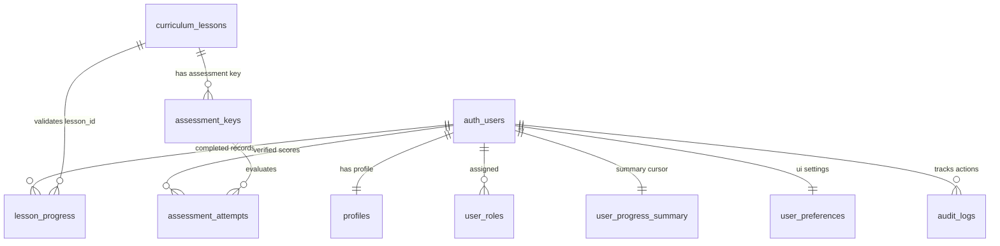
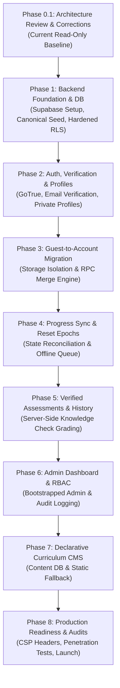

# Backend Requirements and Architecture Specification
## Interactive JavaScript Learning Platform — Phase 0.1 Architecture Review and Corrections

**Version:** 2.0  
**Status:** Revised Phase 0.1 Architecture Specification (Read-Only Planning)  
**Parent Documents:** `constitution.md`, `requirements.md`, `architecture-spec.md`, `curriculum-spec.md`  
**Supercedes:** `backend-architecture-spec.md` v1.0

---

## 1. Executive Summary & Review Baseline

This document presents the revised, hardened backend architecture and functional requirements specification for evolving the Interactive JavaScript Learning Platform from a client-isolated static web application into a complete, secure, multi-tier educational platform.

### Confirmed Architectural Decisions (Baseline)
1. **Backend Platform:** Supabase (Managed PostgreSQL, GoTrue Auth, PostgREST, Realtime, Edge Functions).
2. **Access Model:** Dual-tier support for both anonymous **Guest Learners** and authenticated **Registered Learners**.
3. **Execution Integrity:** Student-submitted JavaScript execution **strictly remains in the browser** across the established tri-modal Web Worker architecture (Ordinary Worker, Controlled DOM Worker, Async Worker). Zero untrusted learner code executes on the backend.
4. **Static Frontend Deployability:** The application remains buildable via Vite as a static client application deployable to static hosts (GitHub Pages, Cloudflare Workers/Pages).

### Corrections & Hardening Introduced in Version 2.0
- **Progress Sync & Reset Semantics:** Deprecated naive Set Union; introduced state reconciliation with authoritative server timestamps, epoch-based progress resets (`last_reset_at`), and device synchronization revisions.
- **Storage Boundary Isolation:** Enforced strict key isolation separating anonymous guest data (`jslearn_guest_progress_v1`) from authenticated account caches (`jslearn_account_<user_id>_*`) to eliminate shared-computer data leakage.
- **Assessment Integrity & Server-Side Grading:** Established architectural distinction between self-reported coding exercises and verified assessments. Designed server-side grading for knowledge checks where private answer keys are never delivered to the client bundle.
- **Administrative Security:** Hardened all `SECURITY DEFINER` database functions with fixed `search_path`, fully qualified schema references, execution privilege revocations, and out-of-band admin bootstrapping.
- **Server-Side Account Deletion:** Designed service-role-mediated account deletion via Supabase Edge Functions with cascading foreign keys and GDPR scrubbing. Zero privileged service-role credentials exposed to the frontend.
- **Relational Schema Hygiene:** Decoupled `active_lesson_id` from UI preferences; defaulted user profiles to private; enforced canonical curriculum foreign-key validation on lesson IDs; normalized `TIMESTAMPTZ` defaults to `now()`.
- **Curriculum CMS Boundaries:** Kept executable validators and test harnesses in Git-versioned code; restricted future CMS capabilities to declarative content fields to eliminate dynamic code evaluation risks.
- **Defense-in-Depth Deployment:** Documented security disparities between GitHub Pages and header-capable hosts (Cloudflare); updated Content Security Policy; established PostgreSQL Row Level Security (RLS) as the primary security boundary rather than CORS.
- **Pervasive Security Gates:** Integrated security review and automated boundary testing into every implementation phase.

---

## 2. Architecture Decision Records (ADRs)

### ADR-001: Supabase as Backend Platform
- **Status:** Approved.
- **Context:** The platform requires relational data persistence, robust authentication, user management, and authorization, while maintaining low maintenance overhead and supporting static client deployment.
- **Decision:** Adopt Supabase (PostgreSQL 15+, GoTrue Auth, PostgREST, Edge Functions). Client connects directly via `@supabase/supabase-js` using the public anonymous key (`anon`).
- **Consequences:** Eliminates custom Node.js server maintenance. Security relies strictly on PostgreSQL Row Level Security (RLS). The database remains standard PostgreSQL, ensuring a seamless migration path to AWS RDS, Google Cloud SQL, or self-hosted Postgres if needed.

### ADR-002: Storage Boundary Isolation on Shared Clients
- **Status:** Approved.
- **Context:** Many learners use public or shared computers (schools, libraries, internet cafes). If guest progress and authenticated progress share the same `localStorage` key, User B logging out leaves their progress exposed to Guest C or User D.
- **Decision:** Partition browser storage into disjoint namespaces:
  1. `jslearn_guest_progress_v1` (active exclusively for unauthenticated sessions).
  2. `jslearn_account_<user_id>_progress_v1` (cached cloud state for specific user).
  3. `jslearn_account_<user_id>_queue_v1` (offline mutations for specific user).
  On logout, active memory is cleared, account caches are unmounted, and the client resets to the guest storage namespace without leaking account data.
- **Consequences:** Completely prevents data crossover between different users on shared machines.

### ADR-003: Progress Synchronization, autoritative Timestamps & Reset Semantics
- **Status:** Approved.
- **Context:** Naive Set Union (`Local ∪ Cloud`) cannot support "Reset Progress" (a stale device would resurrect wiped completions) and does not handle out-of-order writes or offline divergence. Furthermore, existing `localStorage` lacks per-lesson historical timestamps.
- **Decision:**
  1. **Authoritative Server Timestamps:** Client-provided completion timestamps are treated as advisory `client_recorded_at`. The database kernel assigns authoritative `completed_at = now()`.
  2. **Migration Timestamping:** Because the existing `localStorage` schema (`jslearn_progress_v1`) stores only an array of lesson IDs without per-lesson timestamps, migrating guest lessons sets `completed_at = now()` and marks `migration_source = 'guest_migration'`.
  3. **Reset Semantics via Epochs:** Resetting progress is an explicit server operation that records `last_reset_at = now()` in the user's progress summary and deletes completed lesson records. Any incoming offline sync payload where `client_recorded_at < last_reset_at` is discarded as stale.
- **Consequences:** Guarantees deterministic state reconciliation, eliminates progress resurrection bugs, and supports valid progress resets.

### ADR-004: Dual Assessment Integrity & Isolated Server-Side Grading
- **Status:** Approved.
- **Context:** Student code must execute in the browser to avoid server-side security catastrophes (RCE, container escape). However, if knowledge checks and certifications contain answer keys in public JavaScript, learners can inspect client bundles to fake 100% scores.
- **Decision:**
  1. **Self-Reported Coding Exercises:** Interactive exercises run in the client-side Web Worker. Passing status is recorded as practice completion.
  2. **Server-Graded Knowledge Checks:** For verified assessments, question options and prompts are public, but `correctOptionId` is **stripped from the client bundle**. The client submits `{ assessment_id, answers: { q1: "opt_b", q2: "opt_a" } }` to a secure Postgres RPC function or Edge Function `submit_assessment()`. The server compares against the private database key, scores the submission, and records an immutable assessment attempt.
- **Consequences:** Eliminates cheating on graded milestones while keeping code execution completely client-side.

### ADR-005: Security Definer Hardening & RBAC Escalation Prevention
- **Status:** Approved.
- **Context:** PostgreSQL `SECURITY DEFINER` functions run with owner privileges. If `search_path` is mutable, attackers can hijack functions via schema poisoning.
- **Decision:** All privileged functions must explicitly declare `SET search_path = pg_catalog, public`, use fully qualified schema references (`public.user_roles`), and revoke execution from `PUBLIC`. Initial administrator creation is out-of-band via database migrations or direct Supabase SQL Editor execution, never via public API.
- **Consequences:** Immune to search-path injection and self-promotion attacks.

### ADR-006: Server-Side Account Deletion & GDPR Compliance
- **Status:** Approved.
- **Context:** Self-service account deletion must purge `auth.users` and associated data. The Supabase client SDK cannot delete users from `auth.users` using the public `anon` key.
- **Decision:** Route account deletion through a secure Supabase Edge Function (`delete-account`). The function validates the user's active JWT, confirms password/re-authentication, invokes `supabaseAdmin.auth.admin.deleteUser(userId)` using the server-isolated `service_role` key, and triggers cascading database foreign keys.
- **Consequences:** Frontends never hold `service_role` credentials. Full GDPR compliance achieved.

### ADR-007: Declarative CMS vs Version-Controlled Executable Logic
- **Status:** Approved.
- **Context:** A future CMS could tempt administrators to store validator JavaScript functions as strings in the database.
- **Decision:** Executable code validators, Web Worker isolation policies, and test suites must **strictly remain in version-controlled Git code**. The database CMS will manage **only declarative, data-only fields** (markdown copy, objectives, hints, starter code templates, ordering).
- **Consequences:** Eliminates dynamic `eval()` risks on database content and complies with strict CSP `script-src` policies.

### ADR-008: Deployment Header Capabilities & Defense-in-Depth RLS
- **Status:** Approved.
- **Context:** The application must remain deployable to GitHub Pages (which does not support custom HTTP headers) as well as header-capable hosts (Cloudflare Workers/Pages).
- **Decision:**
  1. **Primary Boundary:** PostgreSQL Row Level Security (RLS) is the definitive security perimeter. Even if CORS or CSP headers are absent or misconfigured, unauthorized queries are rejected by the database engine.
  2. **Header Policy:** Document CSP and Worker CSP are applied via `_headers` where supported (Cloudflare). For GitHub Pages, a `<meta>` CSP provides supplemental defense, with documented acknowledgments that Worker script response headers are unavailable on Pages.
- **Consequences:** Application functions safely on GitHub Pages while delivering enterprise-grade defense-in-depth on header-capable hosting.

---

## 3. Existing Application Architecture Audit (Verified)

Inspection of [`app/`](file:///c:/Users/pc/Desktop/javascript-learning/app) confirms:

### 3.1 Application Components & Entry Points
- **Entry Points:** [`app/index.html`](file:///c:/Users/pc/Desktop/javascript-learning/app/index.html) -> [`app/src/main.js`](file:///c:/Users/pc/Desktop/javascript-learning/app/src/main.js) -> `createApp` in [`app/src/app.js`](file:///c:/Users/pc/Desktop/javascript-learning/app/src/app.js).
- **Presentation Layer:** Vanilla JavaScript ES modules. Modular components for Navigation ([`navigation.js`](file:///c:/Users/pc/Desktop/javascript-learning/app/src/components/navigation.js)), Lesson Rendering ([`lesson-view.js`](file:///c:/Users/pc/Desktop/javascript-learning/app/src/components/lesson-view.js)), Code Playground ([`playground.js`](file:///c:/Users/pc/Desktop/javascript-learning/app/src/components/playground.js)), CodeMirror 6 ([`editor.js`](file:///c:/Users/pc/Desktop/javascript-learning/app/src/components/editor.js)), and Knowledge Checks ([`knowledge-check.js`](file:///c:/Users/pc/Desktop/javascript-learning/app/src/components/knowledge-check.js)).
- **Curriculum & Registry:** Canonical course map in [`app/src/curriculum.js`](file:///c:/Users/pc/Desktop/javascript-learning/app/src/curriculum.js) (64 lessons across 9 modules). Content registry in [`app/src/content/index.js`](file:///c:/Users/pc/Desktop/javascript-learning/app/src/content/index.js) imports all 64 statically implemented lessons (`m1-l1.js` to `m9-l9.js`).

### 3.2 Progress Storage Audit & Deficiencies
- **Storage Implementation:** Handled entirely in [`app/src/progress.js`](file:///c:/Users/pc/Desktop/javascript-learning/app/src/progress.js).
- **Key:** Single key `jslearn_progress_v1`.
- **Schema:**
  ```json
  {
    "schemaVersion": 1,
    "completedLessons": ["m1-l1", "m1-l2"],
    "lastUpdated": "2026-11-09T14:30:00.000Z"
  }
  ```
- **Audited Gaps:**
  1. *No per-lesson completion timestamps:* Only one global `lastUpdated` timestamp exists.
  2. *No cursor tracking:* Active lesson ID and current module are not saved to storage.
  3. *No attempt logs or snapshots:* Zero history of code runs or exercise submissions.
  4. *No user isolation:* Storage is shared globally across the browser profile.

### 3.3 Worker Architecture & Execution Protocols
- **Pure JavaScript Runner ([`runner.js`](file:///c:/Users/pc/Desktop/javascript-learning/app/src/runner.js)):** Blob Web Worker with stripped globals (`fetch`, `XMLHttpRequest`, `WebSocket`, `indexedDB`, `caches`, `importScripts`, `Function.prototype.constructor`, `eval`) and 5,000ms watchdog termination.
- **Controlled DOM Runner ([`dom-runner.js`](file:///c:/Users/pc/Desktop/javascript-learning/app/src/dom-runner.js)):** External module worker (`dom-worker.js`) executing a bounded virtual DOM (max 200 nodes, depth 20, 50 listeners). Renders via trusted host DOM methods into [`dom-preview.js`](file:///c:/Users/pc/Desktop/javascript-learning/app/src/components/dom-preview.js). No `innerHTML` injection.
- **Async Runner ([`async-runner.js`](file:///c:/Users/pc/Desktop/javascript-learning/app/src/async-runner.js)):** External worker (`async-worker.js`) tracking microtasks and timer tasks, bridging strictly allowlisted GET requests to `https://jsonplaceholder.typicode.com/todos/1` via [`async-fetch.js`](file:///c:/Users/pc/Desktop/javascript-learning/app/src/async-fetch.js).

### 3.4 Backend & Authentication Footprint
- **Current State:** **0% backend footprint.** No network clients, authentication endpoints, or remote database tables exist.

---

## 4. Guest and Registered-User Access Specification

```
┌────────────────────────────────────────────────────────────────────────┐
│                        ROLE CAPABILITY MATRIX                          │
├──────────────────────────┬───────────┬─────────────┬───────────┬───────┤
│ Capability               │   Guest   │   Learner   │  Editor   │ Admin │
├──────────────────────────┼───────────┼─────────────┼───────────┼───────┤
│ View lessons & run code  │     ✅     │      ✅      │     ✅     │   ✅   │
│ Local guest progress     │     ✅     │      ❌      │     ❌     │   ❌   │
│ Cloud progress sync      │     ❌     │      ✅*     │     ✅     │   ✅   │
│ Verified assessments     │     ❌     │      ✅*     │     ✅     │   ✅   │
│ Cross-device history     │     ❌     │      ✅*     │     ✅     │   ✅   │
│ User profile & settings  │     ❌     │      ✅      │     ✅     │   ✅   │
│ Edit lesson content      │     ❌     │      ❌      │     ✅     │   ✅   │
│ View platform analytics  │     ❌     │      ❌      │     ❌     │   ✅   │
│ Manage users & roles     │     ❌     │      ❌      │     ❌     │   ✅   │
└──────────────────────────┴───────────┴─────────────┴───────────┴───────┘
* Requires verified email address before cloud sync is active.
```

### 4.1 Access Gating & Email Verification
- **Unverified Registered Users:** Upon sign-up, users can access the platform and edit their profile. However, in compliance with confirmed product decisions, **cloud progress synchronization and verified assessment scoring remain blocked until email ownership is verified**. Unverified accounts cache progress in their private account cache (`jslearn_account_<user_id>_progress_v1`) marked as `unverified`.
- **Guest Learner Isolation:** Guests use `jslearn_guest_progress_v1`. Guest operations never touch network endpoints.

---

## 5. Progress Migration, Synchronization & Reset Design

```
┌────────────────────────────────────────────────────────────────────────┐
│               STORAGE ISOLATION & SYNCHRONIZATION FLOW                 │
├────────────────────────────────────────────────────────────────────────┤
│  ANONYMOUS CONTEXT                     AUTHENTICATED ACCOUNT CONTEXT   │
│  ┌─────────────────────────┐           ┌─────────────────────────────┐ │
│  │ jslearn_guest_progress  │           │ jslearn_account_<uid>_cache │ │
│  │ • Completed lesson IDs  │           │ • Verified cloud snapshot   │ │
│  │ • Global timestamp      │           │ • Server sync revision      │ │
│  └────────────┬────────────┘           └──────────────▲──────────────┘ │
│               │ On First Sign-Up / Login              │                │
│               ▼                                       │ Pull Sync      │
│  ┌─────────────────────────┐                          │                │
│  │ Migration Engine        │                          │                │
│  │ • Deduplicate IDs       │                          │                │
│  │ • Assign source=guest   │                          │                │
│  │ • Send to merge RPC     │                          │                │
│  └────────────┬────────────┘                          │                │
│               │ Push                                  │                │
│               ▼                                       │                │
├───────────────┼───────────────────────────────────────┼────────────────┤
│               ▼                                       │                │
│  POSTGRESQL KERNEL                                    │                │
│  ┌────────────────────────────────────────────────────┴─────────────┐  │
│  │ reconcile_user_progress(uid, incoming_lessons, client_recorded)  │  │
│  │ 1. Check user last_reset_at epoch. Discard if client is stale.   │  │
│  │ 2. Insert new completions with completed_at = now().             │  │
│  │ 3. Return authoritative unified progress record.                 │  │
│  └──────────────────────────────────────────────────────────────────┘  │
└────────────────────────────────────────────────────────────────────────┘
```

### 5.1 Storage Architecture
```javascript
// Storage Namespaces
const GUEST_STORAGE_KEY = "jslearn_guest_progress_v1";
const getAccountStorageKey = (uid) => `jslearn_account_${uid}_progress_v1`;
const getAccountQueueKey = (uid) => `jslearn_account_${uid}_queue_v1`;
const getAccountPrefKey = (uid) => `jslearn_account_${uid}_pref_v1`;
```

### 5.2 Guest-to-Account Migration Procedure
1. When an unauthenticated learner logs in or registers:
   - Client inspects `jslearn_guest_progress_v1`.
   - If empty, cloud state is fetched and loaded into `jslearn_account_<uid>_progress_v1`.
   - If guest completions exist, client calls the database RPC `migrate_guest_progress(lesson_ids TEXT[])`.
   - The server verifies that each `lesson_id` exists in the canonical curriculum, inserts rows with `completed_at = now()`, and tags `source = 'guest_migration'`.
   - The guest storage key `jslearn_guest_progress_v1` is **cleared** upon successful migration confirmation.

### 5.3 Deterministic State Reconciliation & Progress Resets
To resolve conflicts without naive union flaws:
1. **Server-Side Summary Tracking:** The `user_progress_summary` table tracks `last_reset_at TIMESTAMPTZ DEFAULT now()`.
2. **Explicit Reset Semantics:**
   - When a user resets progress, client calls `reset_user_progress()`.
   - Server sets `last_reset_at = now()`, deletes all rows from `lesson_progress` where `user_id = auth.uid()`, and increments `sync_revision`.
   - Server returns the empty state.
3. **Stale Device Handling:**
   - Any incoming sync payload from an offline device carries `client_recorded_at`.
   - If `client_recorded_at < last_reset_at`, the server rejects the completion as an obsolete pre-reset mutation.
   - The stale device receives an explicit `FORCE_RESET` signal and purges its local cache.

---

## 6. Assessment Integrity & Server-Side Verification

### 6.1 Two-Tier Evaluation Architecture
| Attribute | Interactive Coding Exercises (Modules 1–9) | Verified Knowledge Checks & Milestone Assessments |
|---|---|---|
| **Execution Context** | Client-Side Dedicated Web Worker | Server-Side PostgreSQL Function / Edge Function |
| **Integrity Tier** | **Learner-Reported Practice** | **Authoritative Verified Result** |
| **Security Rationale** | Preserves `constitution.md` §7; untrusted code never executes on server | Eliminates client-side answer key scraping |
| **Answer Key Exposure** | N/A (Dynamic code validation rules) | **Never in client bundle**; private in DB |
| **Storage Destination** | `exercise_attempts` (deferred / optional) | `assessment_attempts` (verified audit log) |

### 6.2 Knowledge Check Server Grading Flow
1. **Curriculum Delivery:** Client receives questions and multiple-choice options (`id`, `label`, `prompt`), but **not** `correctOptionId`.
2. **Submission:** Upon completing the check, the client submits:
   ```json
   {
     "assessment_id": "m7-l1-assessment",
     "answers": {
       "q1": "sync-end",
       "q2": "promise-job",
       "q3": "complete-order"
     }
   }
   ```
3. **Server Evaluation (`submit_assessment` RPC):**
   - Retrieves encrypted/hashed correct answer key from `assessment_keys` table.
   - Evaluates score mathematically.
   - Records an immutable row in `assessment_attempts`.
   - Returns `{ passed: true, score: 100.0, feedback: [...] }` to the client.

---

## 7. Hardened Database Architecture & Schemas

### 7.1 Entity-Relationship Overview



### 7.2 Database Schema Definitions (PostgreSQL 15+)

#### 1. Canonical Curriculum Seed Table (`curriculum_lessons`)
Ensures foreign-key referential integrity for all lesson references:
```sql
CREATE TABLE public.curriculum_lessons (
    id TEXT PRIMARY KEY, -- e.g. 'm1-l1'
    module_id TEXT NOT NULL,
    title TEXT NOT NULL,
    sequence_order INTEGER NOT NULL UNIQUE,
    created_at TIMESTAMPTZ NOT NULL DEFAULT now()
);
-- Seeded with all 64 canonical lessons from curriculum-spec.md
```

#### 2. User Profiles (`profiles`)
**Privacy Hardened:** Profiles are private by default.
```sql
CREATE TABLE public.profiles (
    id UUID PRIMARY KEY REFERENCES auth.users(id) ON DELETE CASCADE,
    display_name TEXT CHECK (char_length(display_name) <= 50),
    avatar_url TEXT CHECK (avatar_url ~ '^https?://'),
    is_public BOOLEAN NOT NULL DEFAULT false,
    created_at TIMESTAMPTZ NOT NULL DEFAULT now(),
    updated_at TIMESTAMPTZ NOT NULL DEFAULT now()
);

ALTER TABLE public.profiles ENABLE ROW LEVEL SECURITY;

-- Owner can read/update own profile
CREATE POLICY "Users can manage own profile"
ON public.profiles
FOR ALL
TO authenticated
USING (auth.uid() = id)
WITH CHECK (auth.uid() = id);

-- Public can only read profiles explicitly marked public
CREATE POLICY "Public can view public profiles"
ON public.profiles
FOR SELECT
TO authenticated, anon
USING (is_public = true);
```

#### 3. User Progress Summary & Reset Cursor (`user_progress_summary`)
Decouples progress cursor from UI preferences and manages reset epochs:
```sql
CREATE TABLE public.user_progress_summary (
    user_id UUID PRIMARY KEY REFERENCES auth.users(id) ON DELETE CASCADE,
    active_lesson_id TEXT NOT NULL REFERENCES public.curriculum_lessons(id) DEFAULT 'm1-l1',
    completed_count INTEGER NOT NULL DEFAULT 0 CHECK (completed_count >= 0 AND completed_count <= 64),
    sync_revision BIGINT NOT NULL DEFAULT 1,
    last_reset_at TIMESTAMPTZ NOT NULL DEFAULT now(),
    updated_at TIMESTAMPTZ NOT NULL DEFAULT now()
);

ALTER TABLE public.user_progress_summary ENABLE ROW LEVEL SECURITY;

CREATE POLICY "Users manage own progress summary"
ON public.user_progress_summary
FOR ALL
TO authenticated
USING (auth.uid() = user_id)
WITH CHECK (auth.uid() = user_id);
```

#### 4. Individual Lesson Progress (`lesson_progress`)
```sql
CREATE TABLE public.lesson_progress (
    id UUID PRIMARY KEY DEFAULT gen_random_uuid(),
    user_id UUID NOT NULL REFERENCES auth.users(id) ON DELETE CASCADE,
    lesson_id TEXT NOT NULL REFERENCES public.curriculum_lessons(id) ON DELETE RESTRICT,
    completed_at TIMESTAMPTZ NOT NULL DEFAULT now(),
    client_recorded_at TIMESTAMPTZ,
    source TEXT NOT NULL CHECK (source IN ('app_sync', 'guest_migration')) DEFAULT 'app_sync',
    created_at TIMESTAMPTZ NOT NULL DEFAULT now(),
    CONSTRAINT uq_user_lesson UNIQUE (user_id, lesson_id)
);

CREATE INDEX idx_lesson_progress_user ON public.lesson_progress(user_id);
CREATE INDEX idx_lesson_progress_lesson ON public.lesson_progress(lesson_id);

ALTER TABLE public.lesson_progress ENABLE ROW LEVEL SECURITY;

CREATE POLICY "Users manage own lesson progress"
ON public.lesson_progress
FOR ALL
TO authenticated
USING (auth.uid() = user_id)
WITH CHECK (auth.uid() = user_id);
```

#### 5. User Roles & Hardened Security Definer (`user_roles`)
```sql
CREATE TYPE public.app_role AS ENUM ('learner', 'content_editor', 'admin');

CREATE TABLE public.user_roles (
    id UUID PRIMARY KEY DEFAULT gen_random_uuid(),
    user_id UUID NOT NULL REFERENCES auth.users(id) ON DELETE CASCADE,
    role public.app_role NOT NULL DEFAULT 'learner',
    created_at TIMESTAMPTZ NOT NULL DEFAULT now(),
    CONSTRAINT uq_user_role UNIQUE (user_id, role)
);

CREATE INDEX idx_user_roles_lookup ON public.user_roles(user_id, role);

ALTER TABLE public.user_roles ENABLE ROW LEVEL SECURITY;

-- Learners can only view their own roles
CREATE POLICY "Users can read own roles"
ON public.user_roles
FOR SELECT
TO authenticated
USING (auth.uid() = user_id);

-- Hardened Security Definer Helper for Role Checking
CREATE OR REPLACE FUNCTION public.is_admin()
RETURNS BOOLEAN
LANGUAGE plpgsql
SECURITY DEFINER
SET search_path = pg_catalog, public
AS $$
BEGIN
    RETURN EXISTS (
        SELECT 1 FROM public.user_roles
        WHERE user_id = auth.uid() AND role = 'admin'::public.app_role
    );
END;
$$;

-- Restrict function execution
REVOKE ALL ON FUNCTION public.is_admin() FROM PUBLIC;
GRANT EXECUTE ON FUNCTION public.is_admin() TO authenticated;
```

#### 6. User Preferences (`user_preferences`)
Strictly isolated to UI and editor preferences:
```sql
CREATE TABLE public.user_preferences (
    user_id UUID PRIMARY KEY REFERENCES auth.users(id) ON DELETE CASCADE,
    theme TEXT NOT NULL DEFAULT 'dark' CHECK (theme IN ('dark', 'light', 'system')),
    font_size INTEGER NOT NULL DEFAULT 14 CHECK (font_size BETWEEN 10 AND 24),
    editor_word_wrap BOOLEAN NOT NULL DEFAULT true,
    updated_at TIMESTAMPTZ NOT NULL DEFAULT now()
);

ALTER TABLE public.user_preferences ENABLE ROW LEVEL SECURITY;

CREATE POLICY "Users manage own preferences"
ON public.user_preferences
FOR ALL
TO authenticated
USING (auth.uid() = user_id)
WITH CHECK (auth.uid() = user_id);
```

#### 7. Assessment Answer Keys & Attempts (`assessment_keys`, `assessment_attempts`)
```sql
CREATE TABLE public.assessment_keys (
    assessment_id TEXT PRIMARY KEY,
    lesson_id TEXT NOT NULL REFERENCES public.curriculum_lessons(id),
    correct_answers JSONB NOT NULL, -- Private key: {"q1": "sync-end", "q2": "promise-job"}
    passing_score NUMERIC(5,2) NOT NULL DEFAULT 100.00,
    created_at TIMESTAMPTZ NOT NULL DEFAULT now()
);

ALTER TABLE public.assessment_keys ENABLE ROW LEVEL SECURITY;
-- No client can select from assessment_keys; accessible only by server-side RPC functions

CREATE TABLE public.assessment_attempts (
    id UUID PRIMARY KEY DEFAULT gen_random_uuid(),
    user_id UUID NOT NULL REFERENCES auth.users(id) ON DELETE CASCADE,
    assessment_id TEXT NOT NULL REFERENCES public.assessment_keys(assessment_id),
    answers JSONB NOT NULL,
    score NUMERIC(5,2) NOT NULL,
    passed BOOLEAN NOT NULL,
    evaluated_at TIMESTAMPTZ NOT NULL DEFAULT now()
);

ALTER TABLE public.assessment_attempts ENABLE ROW LEVEL SECURITY;

CREATE POLICY "Users read own assessment attempts"
ON public.assessment_attempts
FOR SELECT
TO authenticated
USING (auth.uid() = user_id);
```

---

## 8. Administrative Security & Privileged Operations

### 8.1 Out-of-Band Initial Admin Bootstrapping
- **Vulnerability Blocked:** Insecure public signup endpoints with role parameters.
- **Approved Bootstrap Procedure:**
  1. The initial administrator registers normally via the standard auth flow as a standard learner.
  2. The platform owner runs a dedicated, out-of-band SQL migration or executes via Supabase CLI / Dashboard SQL Editor:
     ```sql
     INSERT INTO public.user_roles (user_id, role)
     VALUES ('<target-uuid>', 'admin'::public.app_role)
     ON CONFLICT (user_id, role) DO NOTHING;
     ```
  3. No HTTP endpoint exists that can assign the `admin` role without active caller verification via `is_admin()`.

### 8.2 Privileged RPC Function Hardening
Every administrative function enforces:
1. `SECURITY DEFINER`.
2. `SET search_path = pg_catalog, public`.
3. Fully qualified table names.
4. Active caller check: `IF NOT public.is_admin() THEN RAISE EXCEPTION 'Access denied'; END IF;`.
5. Automatic insert into `public.audit_logs`.

---

## 9. Server-Side Account Deletion Procedure

```
[Learner Clicks "Delete Account" in UI]
                  │
                  ▼
[Confirm Password Re-Authentication]
                  │
                  ▼
[Invoke Supabase Edge Function: delete-account]
  • Payload: Bearer JWT
                  │
                  ▼
[Edge Function Verification]
  • Verify caller JWT via GoTrue
  • Extract auth.uid()
                  │
                  ▼
[Invoke Supabase Admin API]
  • supabaseAdmin.auth.admin.deleteUser(uid)
                  │
                  ▼
[PostgreSQL Database Cascade]
  • auth.users row deleted
  • CASCADE automatically deletes:
    - profiles
    - user_roles
    - user_progress_summary
    - lesson_progress
    - assessment_attempts
    - user_preferences
                  │
                  ▼
[Edge Function Response 200 OK]
                  │
                  ▼
[Client Teardown]
  • Clear auth session & refresh tokens
  • Clear jslearn_account_<uid>_* from localStorage
  • Reset UI to pristine Guest mode
```

**Security Invariants:**
- Frontend client **never** receives or stores the `SUPABASE_SERVICE_ROLE_KEY`.
- Deletion is unrecoverable and strictly cascades across all relational child records.

---

## 10. Curriculum CMS & Declarative Content Boundaries

```
┌────────────────────────────────────────────────────────────────────────┐
│                        CURRICULUM ARCHITECTURE                         │
├──────────────────────────────────┬─────────────────────────────────────┤
│  VERSION-CONTROLLED REPOSITORY   │  DATABASE CMS (FUTURE PHASE 7)      │
│  (Trusted Executable Logic)      │  (Declarative Copy & Metadata Only) │
├──────────────────────────────────┼─────────────────────────────────────┤
│ • Exercise code validators       │ • Lesson title & module titles      │
│ • Worker execution boundaries    │ • Learning objectives copy          │
│ • Acorn AST parsing & policies   │ • Markdown explanation sections     │
│ • Vitest content test suites     │ • Starter code template strings     │
│ • Async fetch bridge allowlists  │ • Progressive hint strings          │
│ • Playground runner protocols    │ • Estimated completion minutes      │
└──────────────────────────────────┴─────────────────────────────────────┘
```

**Security Invariant:** Under no circumstances will database-stored JavaScript code strings be dynamically evaluated (`eval()`, `new Function()`) in the application context.

---

## 11. Deployment, Security Perimeter & Content Security Policy

### 11.1 Hosting Capability Comparison
| Capability | GitHub Pages | Cloudflare Workers / Cloudflare Pages |
|---|---|---|
| **Static HTML/JS/CSS Delivery** | Supported | Supported |
| **Custom HTTP Response Headers** | **Unsupported** | **Supported** via `_headers` / Worker response |
| **Worker Script Headers** | **Unsupported** | **Supported** (`Content-Security-Policy` per script) |
| **HSTS Enforcement** | GitHub managed | Supported via custom header |
| **Permissions-Policy** | Unsupported | Supported |

### 11.2 Content Security Policy Updates for Supabase
The application CSP must permit Supabase REST endpoints, GoTrue auth, and WebSocket Realtime connections:

```http
Content-Security-Policy: 
  default-src 'none'; 
  script-src 'self' 'unsafe-eval'; 
  worker-src 'self' blob:; 
  style-src 'self' 'unsafe-inline'; 
  img-src 'self' data: blob:; 
  connect-src 'self' https://*.supabase.co wss://*.supabase.co https://jsonplaceholder.typicode.com; 
  object-src 'none'; 
  base-uri 'none'; 
  form-action 'none'; 
  frame-src 'none'; 
  frame-ancestors 'none';
```

### 11.3 Defense-in-Depth Principle
CORS headers protect browsers from cross-origin theft, but do not prevent direct API calls from curl, Postman, or malicious automation. Therefore:
- **PostgreSQL Row Level Security (RLS) is the definitive authorization boundary.**
- Direct API calls without valid user JWTs return zero data, regardless of client origin or spoofed headers.

---

## 12. Phased Implementation Roadmap with Pervasive Security Gates



### Phase 0.1: Architecture Review & Corrections (CURRENT PHASE)
- **Status:** **COMPLETE** (Read-Only Planning).
- **Scope:** Review, corrections, hardened schema design, ADR formulation. Zero code modified.

---

### Phase 1: Backend Foundation and Database
- **Objectives:** Initialize Supabase infrastructure, configure local development via Supabase CLI, and write idempotent SQL migrations.
- **Scope:**
  - Create `curriculum_lessons`, `profiles`, `user_roles`, `user_progress_summary`, `lesson_progress`, `user_preferences`.
  - Seed `curriculum_lessons` with all 64 canonical lessons.
  - Implement hardened `is_admin()` function with `search_path = pg_catalog, public`.
  - Define RLS policies on all tables.
- **Embedded Security Gate:** Automated pgTAP / Node.js test suite proving that unauthenticated callers and unauthorized users cannot select or insert foreign rows.
- **Rollback:** `supabase db reset`.

---

### Phase 2: Authentication, Email Verification and User Profiles
- **Objectives:** User sign-up, sign-in, password reset, and private profile management.
- **Scope:**
  - Install `@supabase/supabase-js`.
  - Implement Auth Service with session persistence and silent token rotation.
  - Accessible login/signup modal with email verification banners.
  - Enforce email verification check before allowing cloud sync activation.
- **Embedded Security Gate:** Verification that unverified users cannot initiate cloud progress writes; verification that passwords and tokens are never relayed to Web Workers or console logs.

---

### Phase 3: Guest Storage Isolation & Migration Engine
- **Objectives:** Establish disjoint storage namespaces and migrate guest progress seamlessly upon registration.
- **Scope:**
  - Migrate storage from `jslearn_progress_v1` to `jslearn_guest_progress_v1` and `jslearn_account_<uid>_progress_v1`.
  - Create atomic RPC `migrate_guest_progress(lesson_ids)` tagging `source = 'guest_migration'`.
  - Ensure shared-computer isolation on sign-out.
- **Embedded Security Gate:** Multi-user shared computer test proving User A cannot see User B's completions after logout.

---

### Phase 4: Cloud Progress Synchronization & Reset Epochs
- **Objectives:** Real-time progress synchronization with offline queue and atomic reset epochs.
- **Scope:**
  - Implement client sync coordinator with offline queue (`jslearn_account_<uid>_queue_v1`).
  - Implement `reset_user_progress()` updating `last_reset_at`.
  - Implement stale device rejection when `client_recorded_at < last_reset_at`.
- **Embedded Security Gate:** Offline network replay tests proving stale devices cannot resurrect wiped progress.

---

### Phase 5: Verified Assessments and History
- **Objectives:** Server-side grading of knowledge checks and persistent milestone assessment scoring.
- **Scope:**
  - Deploy `assessment_keys` and `assessment_attempts` tables.
  - Deploy server-side `submit_assessment()` RPC function.
  - Strip private answer keys from client curriculum bundles for verified assessments.
  - Record code snapshots for completed lessons (disabled by default; opt-in).
- **Embedded Security Gate:** Verification that inspecting frontend network bundles reveals zero answers to graded assessments.

---

### Phase 6: Administration and Role-Based Access Control
- **Objectives:** Administrative dashboard, learner inspection, user moderation, and audit logs.
- **Scope:**
  - Admin layout and routes (`/admin`).
  - Out-of-band admin bootstrapping script.
  - Administrative RPCs protected by `is_admin()` and logged in `audit_logs`.
- **Embedded Security Gate:** Penetration testing confirming non-admin users receive 403 Forbidden on all admin endpoints.

---

### Phase 7: Declarative Curriculum CMS
- **Objectives:** Manage declarative lesson content via database with static bundle fallback.
- **Scope:**
  - Deploy declarative content tables.
  - Hybrid content loader (database fetch with instant fallback to `src/content/`).
  - Content editor role and interface for staging new lesson copy.
- **Embedded Security Gate:** Proof that dynamic execution of database content is impossible; validators remain in Git.

---

### Phase 8: Production Readiness, Security Hardening & Deployment
- **Objectives:** Final security audit, CSP verification, cross-browser certification, and production launch.
- **Scope:**
  - Configure production CSP headers for Supabase.
  - Real-browser automated testing on desktop Chrome, Edge, Firefox, and Safari.
  - Deploy to Cloudflare Workers Static Assets or GitHub Pages.
  - Final release checklist sign-off.
- **Embedded Security Gate:** Penetration testing, RLS audit, secret-leak scans, and WCAG AA accessibility audit.

---

## 13. Distinguishing Decision Status

### Approved Decisions
- Supabase selected as backend platform.
- Client-side Web Worker code execution strictly preserved.
- Dual-tier support for guests and registered users.
- Email verification mandatory before cloud progress synchronization.
- Guest storage isolated from authenticated user caches.
- Code snapshot persistence deferred and disabled by default.
- Content-editor and admin features deferred to subsequent phases (Phases 6 & 7).
- Profiles private by default.
- Declarative CMS only; executable validators stay in Git.

### Proposed Design Details (Ready for Phase 1 Implementation)
- Storage key taxonomy: `jslearn_guest_progress_v1`, `jslearn_account_<uid>_progress_v1`, etc.
- Database schemas with `curriculum_lessons` seed table for referential integrity.
- Epoch-based progress resets via `user_progress_summary.last_reset_at`.
- Server-side grading for knowledge checks via `submit_assessment()`.
- Hardened `SECURITY DEFINER` function template with `search_path = pg_catalog, public`.
- Server-side account deletion via Edge Function using `supabaseAdmin.auth.admin.deleteUser`.

### Deferred to Future Releases
- Social OAuth sign-in (Release 2.0).
- Detailed exercise code attempt history (Release 2.0).
- Multi-course curriculum expansion (Release 3.0+).
- Realtime peer collaboration or social leaderboards (Release 3.0+).

### Unresolved Questions Requiring User Input
1. **Password Re-Authentication on Account Deletion:** Should self-service account deletion require entering the user's current password inside the modal, or is an active authenticated session sufficient? *(Recommended: Require password confirmation for security).*
2. **Assessment Retry Throttling:** Should server-side graded knowledge checks enforce a cooldown period (e.g., 5 minutes after 3 consecutive failures) to prevent brute-forcing multiple-choice questions? *(Recommended: Enforce cooldown on milestone assessments).*

---

*End of Phase 0.1 Specification. Implementation remains paused pending final review and approval.*
